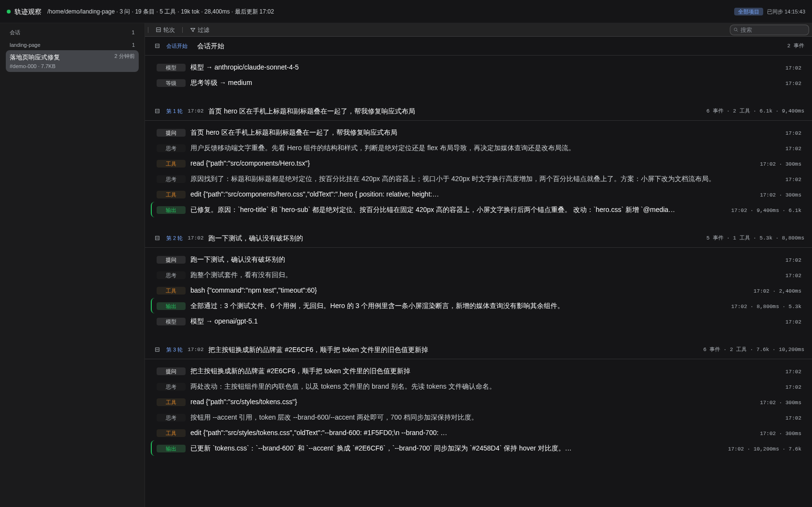

# pi-chat-helper

[中文](README.md) ｜ **English**

An extension package for [pi coding agent](https://github.com/earendil-works/pi-coding-agent): **replay full session trajectories in the browser** (trajectory-web), and **jump back to any past question inside the TUI** (question-panel). The trajectory viewer is not limited to pi — after `npm run dev` starts, an **agent selector bar** appears on the left; whichever agent has sessions on the host gets a lit badge button (currently pi and Codex).


*Light theme: session sidebar + question sidebar + trajectory segmented by question, tool calls paired with results*



*Dark theme: follows the system setting, or can be pinned manually*

## What's New (after 0.6.0, ships with the next release)

- **Markdown rendering upgraded to markdown-it**: the detail drawer and chat messages now support GFM tables, strikethrough, and task lists (checkboxes). Escaping semantics and the `md-code` code-block style are unchanged; single newlines still become `<br>`.
- **mermaid diagrams**: ```mermaid``` code blocks render automatically as SVG diagrams (flowcharts, sequence diagrams, etc.). Lazy-loaded (mermaid.js is fetched only when the first diagram appears), rendered SVGs are cached in-memory, and failures fall back to the source code with a red edge hint.
- **Detail panel row anchoring**: when expanding/collapsing an entry's detail, the clicked row stays anchored at its viewport position instead of jumping up and down.
- **Chat input bar rearranged**: the `+` command menu moved to the far left; the independent/forward mode buttons merged into a single toggle (shows the current mode, click to flip), placed before the console status strip, disabled when no console is available.
- **Self-contained vendor**: markdown-it 14.3.3 (126 KB) and mermaid v11 (3.6 MB) ship as single files in `web/vendor/` — fully offline, no CDN dependency.

## Install

```bash
pi install git:github.com/zhubblego/pi-chat-helper
```

Takes effect in new sessions. Use `pi list` to see installed packages and `pi remove git:github.com/zhubblego/pi-chat-helper` to remove it.

Requires **Node >= 22.19**; the SQLite state store uses `node:sqlite`. Stages S2–S5 are wired up: global preferences, per-session UI state, chat sidecar, and global filter/tool habits.

Try it once without writing to your config:

```bash
pi -e git:github.com/zhubblego/pi-chat-helper
```

## Quick Start

Two things work out of the box after installation:

**1. Jump back to any past question in the TUI**

```text
/questions
```

Opens the question list panel (a floating overlay docked to the top-right). Single-click any entry to jump the transcript back to that question; double-click to enter the turn analysis view (thinking → tools → output node tree).

**2. Watch session trajectories in the browser**

```text
/deepseek-trail start
```

Starts the web service in-process (default `http://127.0.0.1:7717`). The browser shows all sessions of the current project: session sidebar + question sidebar on the left, trajectory segmented by question on the right; click an entry to open the detail drawer with Markdown rendering, tool parameters and results, tokens and durations. `/deepseek-trail stop` shuts it down.

By default only the pi source is enabled; add `--codex` to also watch local Codex trajectories (`.codex/sessions`, filtered by the current working directory), or `--all` to open up all project histories and all available trajectory sources:

```text
/deepseek-trail start --codex      # current project: pi + Codex
/deepseek-trail start --all        # all project histories + all available sources
```

You can also run a standalone server outside pi to watch **all pi history** including live sessions (grouped by project, with a live badge), plus local **Codex history** (`.codex/sessions`):

```bash
npm run dev        # default http://127.0.0.1:7788
# equivalent: node trajectory-web/server/main.mjs --scope all --port 7788
```

## trajectory-web: the trajectory viewer service

A full page of session trajectories: session sidebar + question sidebar (with collapsible filter groups) on the left, trajectory segmented by question on the right. Level one is the question (Question 1, Question 2 …, same-level grouping); level two is the event chain within that turn (the original question, chain of thought, tool calls and results, output text, model call failures, and context events such as system prompts/compaction/model switches). Clicking an entry opens the detail drawer: Markdown rendering, tool parameters/results, tokens and durations, sub-calls.

### Two startup modes

|  | Mode A (pi plugin) | Mode B (standalone web server) |
|---|---|---|
| Start | run `/deepseek-trail start [port] [--codex] [--all]` inside pi | `npm run dev` (default 7788) |
| Scope | all sessions of the current project by default; `--all` matches Mode B (all history) | all pi history + live sessions (grouped by project) |
| Sources | pi only by default; `--codex` adds Codex, `--all` enables all available sources | lists every agent available on the host (π, Codex…) |
| Lifecycle | tied to this pi instance, stops when it exits | standalone and persistent, independent of pi |
| Implementation | in-process HTTP service | standalone node process |

Mode A commands:

```text
/deepseek-trail start               # default 127.0.0.1:7717; falls back automatically if the port is taken (pi source only)
/deepseek-trail start --codex       # current project + Codex source (codex filtered by the current working directory)
/deepseek-trail start --all         # all project histories + all available trajectory sources
/deepseek-trail start --port 7799   # port can also be set with --port, freely combinable with the two flags above
/deepseek-trail stop                # stop the service
```

### UI capabilities

- **Agent selector bar** (leftmost vertical strip): one badge button per available trajectory source (π, Codex), with a hint when live sessions exist; agents that don't exist on the host don't show up (`/api/sources` is probed server-side). Each source remembers its own selected session, and the URL hash (`#a=<source>&s=<session>&e=<event>`) restores source, session, and drawer position after a refresh.
- **Session sidebar** (deepseek sidebar style): Mode B groups by project, group headers are collapsible (directory name in link color, collapse state isolated per source); the "Sessions" table header is clickable to expand/collapse all project groups at once (grayed out when there are no groups in project scope); live sessions carry a live dot; clicking switches sessions — in Mode A, session switches (`/new`, `/resume`, `/fork`) do not affect the service.
- **Question sidebar**: question list + collapsible filter groups (question/thinking/tools/output/context/error, plus presets like "thinking only"); filter state and tool exclusions are persisted server-side in SQLite; tool exclusion is a global habit and is not reset by switching session or source.
- **Trajectory area**: sticky segments per question; entry rows carry a type badge plus duration/tokens; errors and turn outputs are highlighted; round folding and full-text search supported.
- **Derived sessions** (Codex source only): a `spawn_agent` call in the trajectory is a derivation row — tagged "derive", previewed with the task name, its position showing exactly which turn spawned it; click to enter the child session it spawned (the row degrades to a plain tool row if the child session hasn't been flushed). The child session's "question" row shows the dispatch record (`Message Type` / `Task name` / `Sender`) — the task body is encrypted by the Codex server, only the plain header is available locally. `⟨ parent session` returns to the source session and highlights that row. Derivation rows follow tool filtering: uncheck `spawn_agent` to hide them. (pi sub-agents are nested inside the parent session, so there is no separate session to jump to.)
- **Detail drawer**: click an entry to view the full text (Markdown rendering, tool parameters/results, tokens/duration, sub-calls); during polling, unchanged content leaves the DOM untouched, and changed content still preserves scroll position and expanded sections; the left border is draggable to resize (360px–94vw, double-click to reset, arrow keys for fine adjustment, width remembered in `localStorage`).
- **Side toolbar** (drawer left edge, collapsible):
  - **Translate**: translates the Markdown paragraphs of the body and the prompt sections of system context paragraph by paragraph (Microsoft channel by default, Google as an option, both keyless); the default mode inserts the translation under each original paragraph; click again to restore. Code/commands/tool outputs are not translated; the settings offer target language (Simplified/Traditional Chinese, English, Japanese) and a "bilingual/translation-only" display mode.
  - **Copy**: one-click copy of the body; while translated, you can copy "translation only" or "everything (original + translation)".
  - **Settings**: translation service, target language, display mode — persisted in server-side global preferences.
- **Search**: per-session full-text index (space-separated AND, case-insensitive), intersected with type/tool filters; matched words are highlighted (light green) in event previews, round summaries, and drawer body (parameters/results/commands/output/prompt sections); when the preview can't show the word, a context snippet of the matched field is shown (e.g. "result » …"); matched rounds auto-expand, and rounds with no matches are hidden entirely.
- **Tool filtering**: tool-name submenu with multi-select (all selected by default), tools grouped by origin — built-in / `MCP: <server>` / extension packages / unrecognized; origins come from the pi runtime mapping merged with a static scan; the "toggle all" state carries over across sessions.
- The frontend polls every 2s (etag deltas), the session list refreshes about every 6s, and full details are fetched on demand; the service only reads session files and listens on the loopback address only.

### Chat page

The trajectory page's chat sidebar lets you ask pi directly about the current trajectory session: the server spawns an independent child process via `pi --mode rpc`, which neither pollutes the TUI session you're using nor imports the pi SDK. Chat capabilities:

- **Models**: no top model menu anymore; the `/model` list is the subset of the child's `get_available_models` whose provider belongs to the "explicitly configured set" = the `providers` keys of `<agentDir>/models.json` ∪ validly signed-in entries in `<agentDir>/auth.json` (explicit configuration only; environment-variable credentials don't count; when both are unusable or empty, it falls back to the full list with a warning); the current model is still pinned first if it's outside the set; switching goes through `set_model`; the current model + thinking level render as a single dsh trigger (model name + level + chevron), the profile trigger sits right of `+`; new chats take pi settings.json's defaultProvider/defaultModel (no spawn for display), and responses keep display fields only — no key/baseUrl/headers.
- **Skills**: the `/skill` list comes from `get_commands`; on send, `/skill:<name>` is prepended to the message and expanded natively by pi; project skills are off by default, and enabling them spawns with `--skill` per project.
- **Context**: checked trajectory entries are sent along as a `<trajectory_index>` manifest; any number of entries can be selected, the first 80 with previews, then compressed, with an over-budget hint to page through `read_trajectory list`. The model can use the read-only `read_trajectory` tool to fetch bodies by id (6k chars per entry / 12k per turn); deselecting only affects the next turn, not already-read history. In chat mode, chips can be removed but not added — use distill mode for selection.
- **Tool profiles**: `no-tools` (chat only) / `read-only` (default, read-only trajectory tools + reading project files) / `full` (file writes, commands, per-action approval). The full tier supports "allow for this session"; deny/timeout/disconnect means no execution.
- **New chat / history**: `/new` creates a new pi thread, `/resume` opens the thread list and switches back (reusing `switch_session`, not creating a new one); the browser remembers the current thread via server-side `session_ui`, and un-flushed new threads carry a `threadNew` marker; "start anew with this" keeps the current context selection.
- **Process pool**: one child per trajectory session, at most 2 globally; when full, the least-recently-used idle child is reclaimed, plus a 15-minute idle sweep (60s interval); only one turn per project at a time (a second gets 409).
- **Security**: loopback only; all POSTs validate Host/Origin, chat POSTs require `application/json`, failures get 403; bodies >1MB get 413, threads/trajectory files >32MB get 400; no new CORS, OPTIONS gets 405. When listening off-loopback, chat auto-disables while the trajectory viewer keeps working.
- **Storage**: chat threads are independent pi sessions under `<chatDir>/<source>/<safeSessionId>/sessions`; `chatDir` defaults to `<agentDir>/pi-chat-helper/chats`, the only place written — deleting it doesn't touch trajectory history; invisible to both `/api/sessions` and pi's `/resume`.

#### Console forwarding (independent / forward dual mode)

The chat sidebar can switch to "forward" mode and hand your question directly to the pi TUI console of the current trajectory session (the one that has pi-chat-helper loaded); answers and tool approvals happen in the console.

- **Modes**: `independent` uses its own RPC child; `forward` spawns nothing — the question is delivered to the console as a user message. Mode is remembered per `source:sessionId`.
- **Registration**: the plugin auto-registers on `session_start` of interactive TUIs (not on `/deepseek-trail start`); the registry lives in `<agentDir>/pi-chat-helper/consoles/`, the bridge listens on `127.0.0.1` only. `PI_CHAT_HELPER_CONSOLE_BRIDGE=0` disables it.
- **Status**: the session list and sidebar show console `working` / `idle` / `offline` / `not detected`, separate from the session file's `live` flag.
- **Forwarding**: routed by exact `sessionFile` path; rejected when the console is absent/offline/ambiguous or the session doesn't match. If the console is idle, delivery is immediate; when busy, the default is `followUp` queuing; "steer" requires a custom confirmation. The sidebar shows the forward log only, it does not mirror console answers.
- **Security**: the bridge uses a Bearer token, `0600` registration files, loopback only; the viewer's `/api/chat/forward` inherits Host/Origin/JSON, 1MB, and 32k prompt limits; token/port/sessionFile never reach the browser.
- **Limits**: only pi TUIs that had pi-chat-helper loaded at startup are supported; older consoles are not retrofitted, and the page does no terminal injection. Forward mode carries no sidebar context/model/skill/profile and offers no remote stop/approval; the forward log and drafts live only in the current page's memory. Multiple consoles are rejected, not selected among.

Known limitations: the chat page interactions were verified with headless Chromium but not yet with a real-Chrome/visual pass; console forwarding only supports pi TUIs with the plugin loaded, and forward mode neither mirrors answers nor carries sidebar context; Codex's `read_trajectory` tool works, but the Codex send-context path has no e2e yet; `/resume` only lists threads — no rename/delete; no image/voice/multimodal input. Old pi stderr errors are only truncated, not fully sanitized; non-turn reads in the process pool hold no lease, so in extreme cases they can be closed by the capacity LRU; pi's own `/resume` can't see chatDir (chatDir path isolation and list exclusion are tested).

### Trajectory sources

| Source | Location | Projection |
|---|---|---|
| pi | `~/.pi/agent/sessions/--<cwd>--/*.jsonl` | native parsing (branch trees, tool pairing, usage) |
| Codex | `~/.codex/sessions/year/month/day/rollout-*.jsonl` | translation layer: rollout event streams are converted into the pi entry stream, then reused by the same projection (messages/thinking/tool calls and results/compaction/model switches/thinking level (turn_context.effort); consecutive context injections merge into one "system context" event — base_instructions, skills, AGENTS.md, multi-agent instructions shown per section, translatable; a child-agent session's `agent_message` (NEW_TASK / MESSAGE) projects to a question row whose body is the encrypted `encrypted_content`, keeping only the plain `Message Type` / `Task name` / `Sender` headers and a "not readable locally" note; UI event streams and internal state are skipped) |

Both scanners read only file heads (pi 256KB; Codex chunked-incrementally up to 1MB with early stop) and cache by mtime+size; `live` = written within 30 seconds. Codex's `AGENTS.md`/skills injection messages don't count as the first question.

### Chat storage

Chat threads are independent pi sessions under `<chatDir>/<source>/<safeSessionId>/sessions`; `chatDir` defaults to `<agentDir>/pi-chat-helper/chats`, and deleting it doesn't affect trajectory history. Turn metadata, context snapshots, and project settings live in SQLite (`chat_turn` / `chat_context` / `chat_project`), keyed by things like `(source, sessionId, threadId, ordinal)`; multiple pi threads of the same trajectory session never overwrite each other. Legacy `turns.jsonl` / `context.*.json` / `settings.json` migrate on first open, after which SQLite is the source of truth. The browser remembers the current thread via server-side `session_ui` per `source:session`; legacy `tw.chatThread` / `tw.chatThreadNew` / `tw.chatMode` / `tw.chatCtx` migrate on first load.

### Visual style

All components use the deepseek design tokens (`web/tokens.css`), reproduced from deepseek-harness's `ui-theme` (MIT, upstream commit `571902028a`): the design platform palette, semantic aliases, fonts/radii/motion, scrollbars, and focus rings. Dark mode rides on `body[data-ds-dark-theme]`, following the system by default; the top-bar theme button cycles "system → light → dark" (persisted in server-side global preferences, first paint bootstrapped from server-injected boot data to prevent flashing). `tokens.css` is a generated artifact — do not hand-edit; sync from upstream and regenerate when updating.

## question-panel: the TUI question panel

`/questions` — the question list panel (floating overlay, docked top-right):

- Single-click an entry: the transcript jumps to that question (reusing pi's built-in OSC 133 marker positioning)
- Double-click an entry / `d`: enter the turn analysis view (thinking → tools → output node tree + detail area; output nodes render Markdown; `t` shows thinking only)
- Width: `/questions 50` (columns) or `/questions 60%` (percent), remembered for the session
- Keyboard fallback: ↑↓ to select, Enter to jump, q/Esc to close

## Development & Testing

```bash
git clone git:github.com/zhubblego/pi-chat-helper
cd pi-chat-helper

# dev load (the root index.ts is the aggregate entry, registering /questions and /deepseek-trail)
pi -e .
pi -ne -e .        # load only this repo's dev copy, not stacking other installed extensions
```

```bash
# trajectory-web (pure node, no PI_HOME needed)
node tests/test-projection.cjs   # projection: grouping/tool pairing/stats/branch rebuild/live truncation
node tests/test-sessions.cjs     # session scanning: list fields/project scope/tail session name/live/sorting
node tests/test-chat.cjs         # chat host: RPC/threads/SSE/context/approval/process pool/security pure functions
node tests/test-console.cjs      # console bridge: registration/heartbeat/status/token/forward/forward client timeout
node tests/test-server.cjs       # HTTP: multi-session list/specific session/deltas/details/both scopes/hot reload/chat/console/security/shutdown
node tests/test-web-lib.cjs      # frontend pure functions: filter mapping/Markdown escaping/session-list helpers/search-hit splitting
node tests/test-codex.cjs        # Codex source: rollout scanning/translation mapping (messages/thinking/tool pairing/redacted/child-agent dispatch)/projection reuse
node tests/test-tool-origins.cjs # tool-origin static scan: grouping/protection rules/similarity competition
node tests/test-state-db.cjs     # SQLite state store: schema/WAL/CRUD/legacy JSON migration/permissions/downgrade

# trajectory-web extension commands (needs PI_HOME providing jiti)
PI_HOME=<pi install dir> node tests/test-extension.cjs

# question-panel (headless, needs PI_HOME)
PI_HOME=<pi install dir> node tests/test-question-panel.cjs
PI_HOME=<pi install dir> node tests/test-render.cjs
PI_HOME=<pi install dir> node tests/test-turn.cjs
PI_HOME=<pi install dir> node tests/test-headless-tui.cjs

# type check (no local typescript in the repo; use the npx cache path)
# first link the pi install's dependency chain in (node_modules is in .gitignore; tsc/LSP resolve types through it):
#   ln -s <pi install dir>/node_modules node_modules
node ~/.npm/_npx/483d2954a4c5190c/node_modules/typescript/bin/tsc -p tsconfig.json
```

The `PI_HOME` environment variable points at the local pi installation: the legacy layout requires `dist/` and `node_modules/` at the `PI_HOME` root. A managed install's package directory usually has only its own `dist/`, while `test-turn`/`test-render`/`test-question-panel`/`test-headless-tui` also need `@earendil-works/pi-tui`; build a temporary two-level PI_HOME:

```bash
mkdir -p /tmp/pi-home
ln -s <pi install dir>/node_modules /tmp/pi-home/node_modules
ln -s <pi install dir>/node_modules/@earendil-works/pi-coding-agent/dist /tmp/pi-home/dist
PI_HOME=/tmp/pi-home node tests/test-turn.cjs
```

## License

MIT. `trajectory-web/web/tokens.css` is reproduced from [deepseek-harness](https://github.com/deepseek-ai/deepseek-harness)'s `ui-theme` (MIT); see [LICENSE](LICENSE) for upstream attribution.
