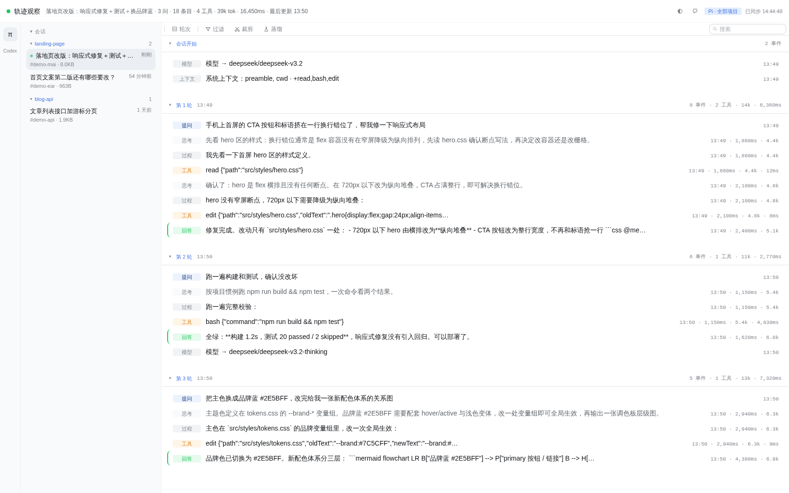
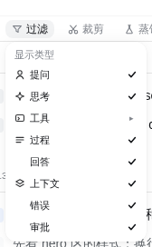
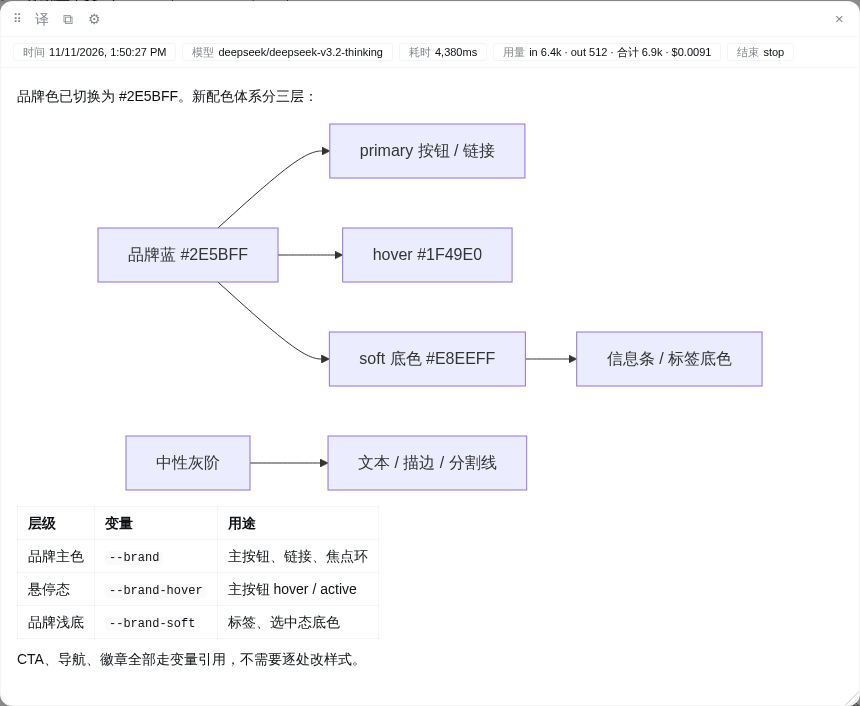
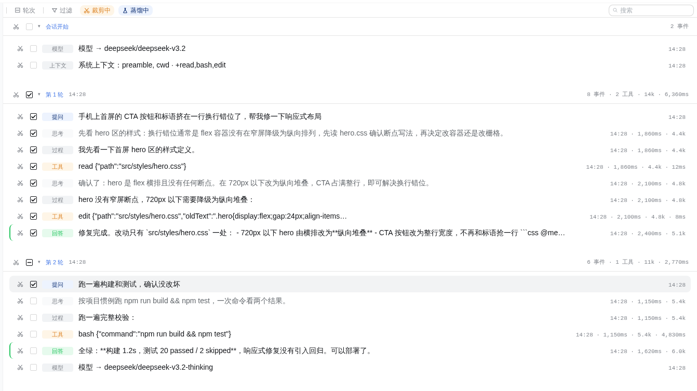
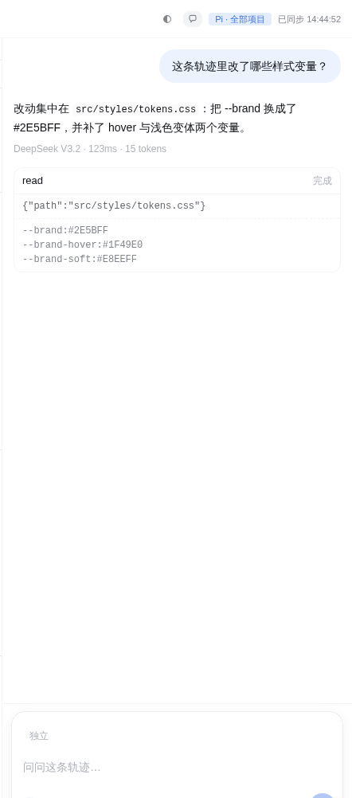
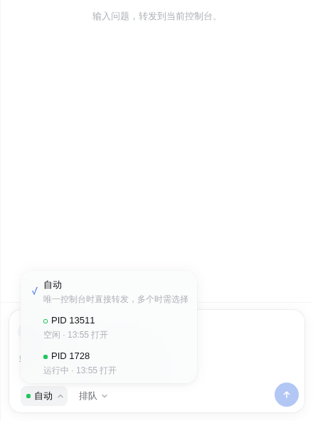
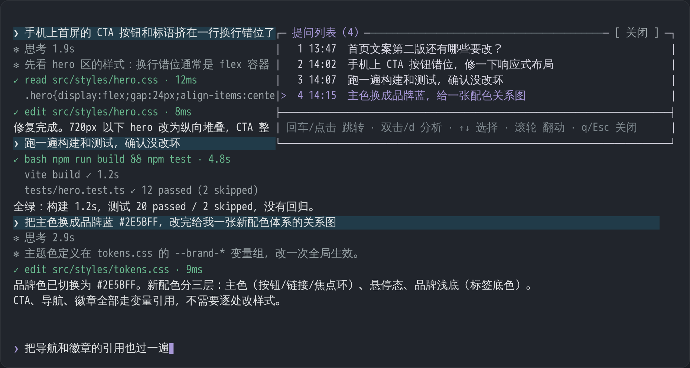

# pi-chat-helper

[中文](README.md) ｜ **English**

An extension package for [pi coding agent](https://github.com/earendil-works/pi-coding-agent): **replay full session trajectories in the browser** (trajectory-web), and **jump back to any past question inside the TUI** (question-panel). The trajectory viewer is not limited to pi — whichever agent has sessions on the host gets a lit button in the left-hand agent selector bar (currently pi and Codex).



*Trajectory page: session sidebar + question sidebar + trajectory segmented by question, tool calls paired with results*

## Key Features

### Trajectory replay · trajectory-web

Replay the full trajectory segmented by question: chain of thought, tool calls paired with results, answers, errors, and context events in order; errors and answers are highlighted, turns can be collapsed, and live sessions carry a live badge.

**Message type filters** — question, thinking, tool, process, answer, compaction, context, error, and approval combine freely, tool names are multi-selectable; filter preferences persist across sessions. **Trajectory perspective** — "Full" shows every entry in the file (including history already compacted away), while "Model" shows only the model's current context: the compaction summary plus subsequent un-cropped entries, with fully compacted rounds hidden; the preference persists across sessions.



**Detail modal** — click any entry to expand it: Markdown, tables, mermaid diagrams, tool parameters and results, tokens and durations; no backdrop, so the page and chat input stay usable while you read; draggable, resizable from the bottom-right corner, and its position and size persist across entry switches and reopens.



**Crop and distill** — two editing modes that manage context right on the trajectory:



- **Crop**: click the scissors to cut a whole round or a single entry out of the model's context — the model no longer sees them in later turns; click again to undo. Only the current pi session can be cropped; other sessions are read-only
- **Distill**: check valuable entries (the round header selects the whole round) as context for the chat page, sent along with your message to the model
- Both modes can be on at once; selection and cropping never affect each other

Also:

- Full-text search: hit highlighting, turns without hits auto-collapse
- Multiple agent sources: native pi parsing + Codex trajectory translation; Codex derived sessions jump on click, one click back to the parent
- Paragraph-by-paragraph translation (Microsoft / Google, no key), bilingual or translation-only; one-click copy
- Light and dark themes follow the system or pin manually; the URL remembers source, session, and position — refresh restores everything

### Chat page · chat

Ask pi directly in the browser about any trajectory session — answers come from an independent child process, so your TUI session is never touched.



- Use distill mode to check trajectory entries as context; the model fetches full texts on demand via a read-only tool
- `/model` to switch models, `/skill` for skills, three tool profiles (chat-only / read-only / full, approval per turn)
- Chat threads are stored separately; deleting them never affects trajectory history, and the service listens on loopback only

**Console forwarding** — stay on the web page and drive your agent: questions go straight into a running pi TUI console; the agent works there, answers and tool approvals happen in the console, and you never switch back and forth between the page and the terminal.



- Target menu: with multiple consoles open, every candidate is listed (PID, run state, opened at) — pick one to forward directly; "Auto" routes straight when there is exactly one console
- Delivery menu: choose "queue" or "interrupt" when the console is busy
- A single toggle flips "independent / forward", and the mode is remembered per session

### TUI question panel · question-panel

`/questions` opens a floating panel (docked to the top-right): single-click an entry to jump the transcript back to that question; double-click / `d` to enter the turn analysis view (thinking → tools → output node tree); ↑↓ to select, Enter to jump, q / Esc to close, `/questions 60%` adjusts the width.



> Note: if the conversation has been compacted, jumps to earlier questions may no longer work — the entries still appear in the panel, but their positions are gone from the transcript.

## Install

```bash
pi install git:github.com/zhubblego/pi-chat-helper
# or, published on npm:
pi install npm:pi-chat-helper
```

Takes effect in new sessions. Use `pi list` to see installed packages and `pi remove git:github.com/zhubblego/pi-chat-helper` to remove it.

Requires **Node >= 22.19** (the state store uses `node:sqlite`).

Try it once without writing to your config:

```bash
pi -e git:github.com/zhubblego/pi-chat-helper
```

## Quick Start

Two things work out of the box after installation:

**1. Jump back to any past question in the TUI**

```text
/questions
```

**2. Watch session trajectories in the browser**

```text
/deepseek-trail start               # default 127.0.0.1:7717, all sessions of the current project (auto-falls back on port conflicts)
/deepseek-trail start --codex       # current project: pi + Codex (codex filtered by the current working directory)
/deepseek-trail start --all         # all project histories + all available sources
/deepseek-trail start --port 7799   # port can be combined with either switch above
/deepseek-trail stop                # stop the service
```

You can also run a standalone server outside pi to watch **all pi history** including live sessions (grouped by project, with a live badge), plus local **Codex history**:

```bash
npm run dev        # default http://127.0.0.1:7788
# equivalent: node trajectory-web/server/main.mjs --scope all --port 7788
```

## Two startup modes

|  | Mode A (pi plugin) | Mode B (standalone web server) |
|---|---|---|
| Start | run `/deepseek-trail start [port] [--codex] [--all]` inside pi | `npm run dev` (default 7788) |
| Scope | all sessions of the current project by default; `--all` same as mode B | all pi history + live sessions (grouped by project) |
| Sources | pi only by default; `--codex` adds Codex, `--all` all available | lists every agent available on the host (pi, Codex, …) |
| Lifetime | bound to this pi instance, stops when it exits | standalone and persistent, independent of pi |
| Implementation | in-process HTTP service | separate node process |

## Trajectory sources

| Source | Location | Projection |
|---|---|---|
| pi | `~/.pi/agent/sessions/--<cwd>--/*.jsonl` | native parsing (branch tree, tool pairing, usage) |
| Codex | `~/.codex/sessions/year/month/day/rollout-*.jsonl` | translation layer: rollout event streams are translated into pi entry streams and reuse the same projection (messages, thinking, tool pairing, compaction, model switches, effort levels); consecutive context injections are merged into one "system context" event; UI event streams and internal state are skipped |

List scans only read file headers (pi 256KB, Codex chunked with early stop) and cache by mtime+size; `live` means written within the last 30 seconds. The service only reads session files and listens on the loopback address only.

## Known limitations

- Chat page interactions are verified with automated headless Chromium; no manual visual acceptance in a real Chrome yet.
- Console forwarding only supports pi TUI consoles that loaded pi-chat-helper at startup (older consoles are not retrofitted); forward mode does not mirror console answers and does not carry the sidebar context, model, skills, or profile.
- The Codex `read_trajectory` tool is supported, but the Codex send context path has no e2e coverage.
- `/resume` offers thread selection only — no rename/delete; no image/audio/multimodal input.

## Development & Testing

```bash
git clone git:github.com/zhubblego/pi-chat-helper
cd pi-chat-helper

# dev load (the root index.ts is the aggregate entry, registering /questions and /deepseek-trail)
pi -e .
pi -ne -e .        # load only this repo's dev version, without stacking other installed extensions
```

```bash
# trajectory-web (pure node, no PI_HOME needed)
node tests/test-projection.cjs   # projection: grouping/tool pairing/stats/branch rebuild/light truncation
node tests/test-sessions.cjs     # session scanning: list fields/project scope/trailing session names/live/sorting
node tests/test-chat.cjs         # chat host: RPC/threads/SSE/context/approval/process pool/security pure functions
node tests/test-console.cjs      # console bridge: registration/heartbeat/state/token/forward/forward client timeout
node tests/test-server.cjs       # HTTP: multi-session lists/named sessions/incremental/details/dual scope/hot update/chat/console/security/exit
node tests/test-web-lib.cjs      # frontend pure functions: filter mapping/Markdown escaping/session list helpers/search hit splitting
node tests/test-codex.cjs        # Codex source: rollout scanning/translation mapping (messages/thinking/tool pairing/redacted/sub-agent dispatch)/projection reuse
node tests/test-tool-origins.cjs # tool-origin static scan: grouping/protection rules/similarity competition
node tests/test-state-db.cjs     # SQLite state store: schema/WAL/CRUD/legacy JSON migration/permissions/degradation

# trajectory-web extension commands (needs PI_HOME for jiti)
PI_HOME=<pi install dir> node tests/test-extension.cjs

# question-panel (headless, needs PI_HOME)
PI_HOME=<pi install dir> node tests/test-question-panel.cjs
PI_HOME=<pi install dir> node tests/test-render.cjs
PI_HOME=<pi install dir> node tests/test-turn.cjs
PI_HOME=<pi install dir> node tests/test-headless-tui.cjs

# type check (no local typescript in the repo; use the npx cache path)
# first link the pi install's dependency chain in (node_modules is in .gitignore; tsc/LSP resolve types through it):
#   ln -s <pi install dir>/node_modules node_modules
node ~/.npm/_npx/483d2954a4c5190c/node_modules/typescript/bin/tsc -p tsconfig.json
```

The `PI_HOME` environment variable points to the local pi install directory: the legacy layout requires `dist/` and `node_modules/` at the `PI_HOME` root. A managed install's package directory usually only has its own `dist/`, while `test-turn`/`test-render`/`test-question-panel`/`test-headless-tui` also need `@earendil-works/pi-tui`; you can build a temporary two-level PI_HOME:

```bash
mkdir -p /tmp/pi-home
ln -s <pi install dir>/node_modules /tmp/pi-home/node_modules
ln -s <pi install dir>/node_modules/@earendil-works/pi-coding-agent/dist /tmp/pi-home/dist
PI_HOME=/tmp/pi-home node tests/test-turn.cjs
```

## License

MIT. `trajectory-web/web/tokens.css` is reproduced from the `ui-theme` module of [deepseek-harness](https://github.com/deepseek-ai/deepseek-harness) (MIT, upstream commit `571902028a`); see [LICENSE](LICENSE) for attribution. It is a generated artifact — do not edit by hand.
