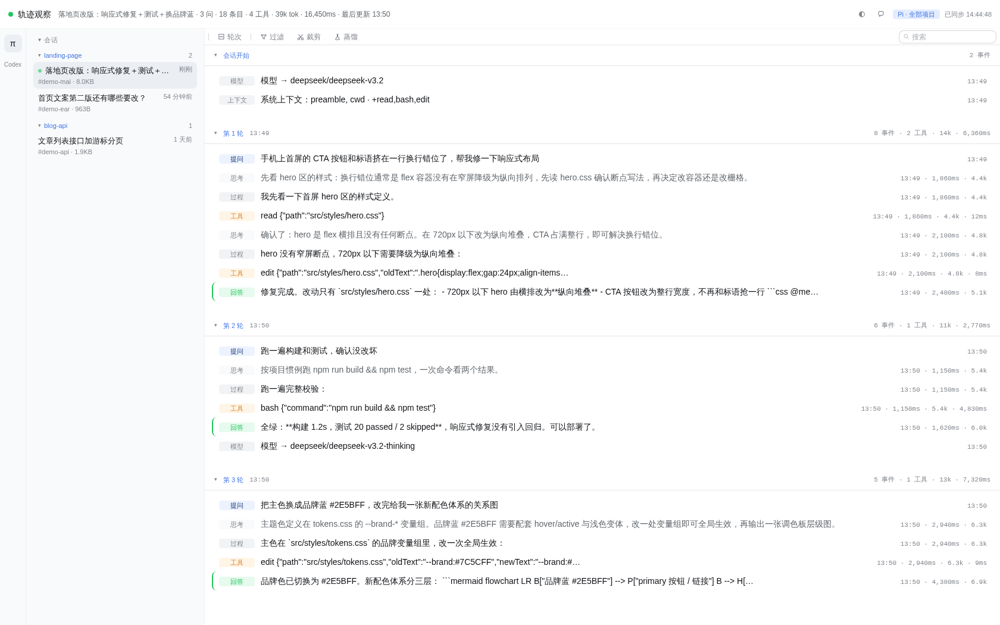
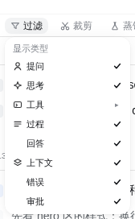
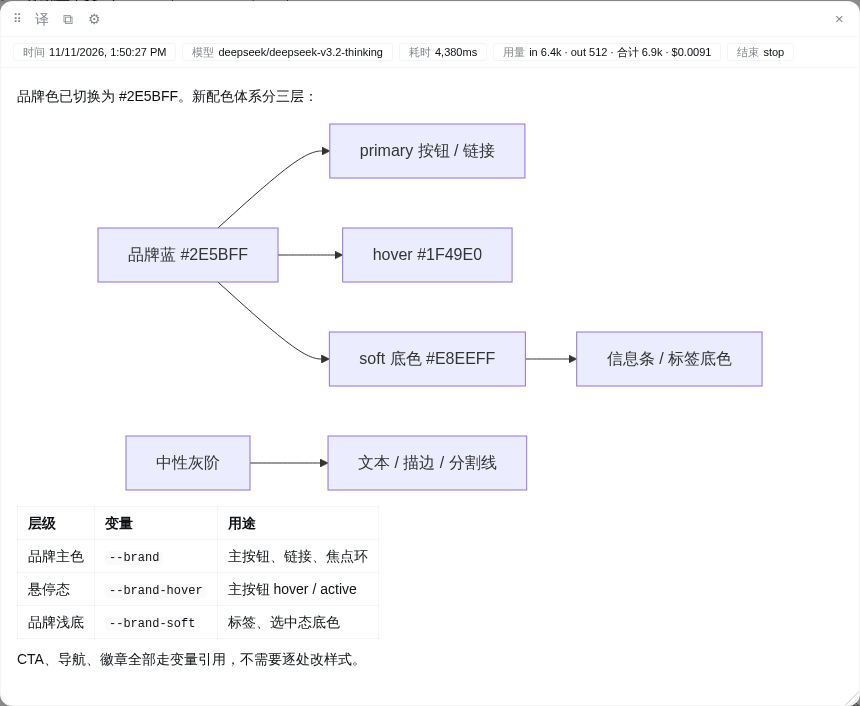
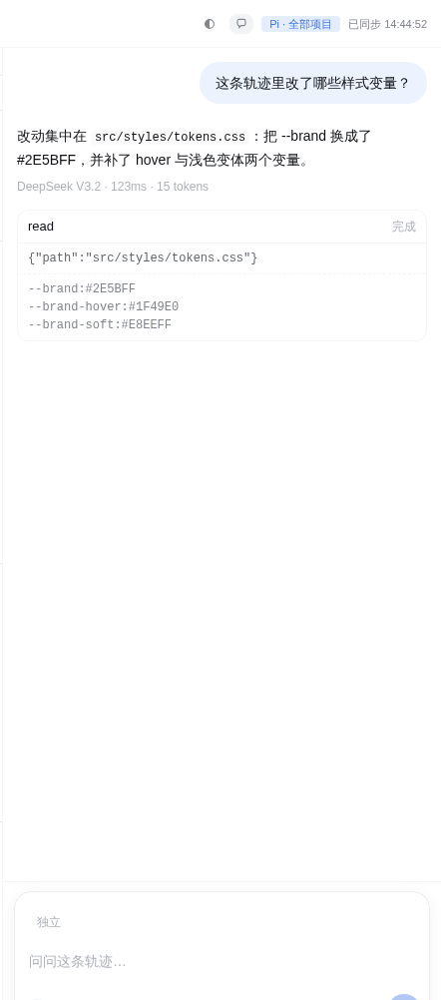
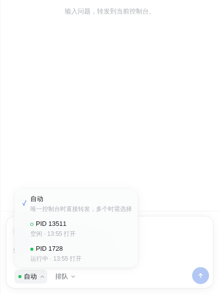

# pi-chat-helper

**中文** ｜ [English](README.en.md)

[pi coding agent](https://github.com/earendil-works/pi-coding-agent) 扩展包：**在浏览器里完整回看会话轨迹**（trajectory-web），**在 TUI 里快速跳转历史提问**（question-panel）。轨迹观察不只支持 pi——宿主机上有哪个 agent 的会话，左侧 Agent 选择栏就亮哪个按钮（当前支持 pi 与 Codex）。



*轨迹页：会话栏 ＋ 问题栏 ＋ 按提问分段的轨迹，工具调用与结果成对展示*

## 主要功能

### 轨迹回看 · trajectory-web

按提问分段回看完整轨迹：思维链、工具调用与结果、回答、错误与上下文事件成链展示；错误与回答高亮，轮次可折叠，运行中的会话带 live 徽标。

**消息类型过滤**——提问、思考、工具、过程、回答、上下文、错误、审批自由组合，工具名可多选；过滤偏好跨会话记住。



**详情弹窗**——点击任意条目展开：Markdown、表格、mermaid 图表、工具参数与结果、tokens 与耗时；弹窗可拖动、右下角拖拽放大。



其他能力：

- 全文搜索：命中高亮，无命中的轮次自动收起
- 多 agent 源：pi 原生解析 ＋ Codex 轨迹翻译；Codex 的派生会话点击跳转、一键回主会话
- 正文逐段翻译（微软 / Google，免 key），双语对照或仅译文；一键复制原文或译文
- 深浅主题跟随系统，也可手动切换；URL 记住当前源、会话与位置，刷新即恢复

### 对话页 · chat

在浏览器里针对任意轨迹会话直接问 pi——回答走独立子进程，不污染你正在用的 TUI 会话。



- 勾选轨迹条目作为上下文，模型按需用只读工具取正文
- `/model` 换模型，`/skill` 用技能，工具权限三档（仅对话 / 只读 / 可写，逐次审批）
- 对话线程独立落盘，删除不影响轨迹历史；服务只监听本机回环地址

**控制台转发**——留在网页里指挥你的 agent：把提问直接送进正在运行的 pi TUI 控制台，agent 在那边干活、回答与工具审批都在控制台完成，你不用在网页和终端之间来回切换。



- 目标菜单：多开控制台时列出全部候选（PID、运行状态、打开时间），选定即定向转发；「自动」在只有一座控制台时直接路由
- 方式菜单：控制台忙碌时可选「排队」或「插话」
- 「独立 / 转发」单钮切换，模式按会话记住

### TUI 提问面板 · question-panel

`/questions` 打开浮动面板（停靠右上角）：单击条目，transcript 直接跳回那一问；双击 / `d` 进入回合分析视图（思考→工具→输出节点树）；↑↓ 选择、回车跳转、q / Esc 关闭。`/questions 50`（列数）或 `/questions 60%`（百分比）调宽度。

## 安装

```bash
pi install git:github.com/zhubblego/pi-chat-helper
# 或已发布到 npm：
pi install npm:pi-chat-helper
```

新开会话生效。`pi list` 查看已装扩展包，`pi remove git:github.com/zhubblego/pi-chat-helper` 移除。

运行环境要求 **Node >= 22.19**（状态库使用 `node:sqlite`）。

想先试用一次、不写入配置：

```bash
pi -e git:github.com/zhubblego/pi-chat-helper
```

## 快速上手

安装后两件事开箱即用：

**１．TUI 里跳回任意历史提问**

```text
/questions
```

**２．浏览器里看会话轨迹**

```text
/deepseek-trail start               # 默认 127.0.0.1:7717，当前项目全部会话（端口占用自动降级并提示）
/deepseek-trail start --codex       # 当前项目：pi + Codex（codex 按当前工作目录过滤）
/deepseek-trail start --all         # 全部项目历史 + 全部可用轨迹源
/deepseek-trail start --port 7799   # 端口可与上面两个开关任意组合
/deepseek-trail stop                # 停止服务
```

也可以脱离 pi 跑独立服务，观察**全部 pi 历史**与运行中会话（按项目分组、live 徽标），以及本机 **Codex 历史**：

```bash
npm run dev        # 默认 http://127.0.0.1:7788
# 等价：node trajectory-web/server/main.mjs --scope all --port 7788
```

## 两种启动模式

|  | 模式 A（pi 插件） | 模式 B（独立 web server） |
|---|---|---|
| 启动 | pi 内执行 `/deepseek-trail start [端口] [--codex] [--all]` | `npm run dev`（默认 7788） |
| 范围 | 缺省当前项目的全部会话；`--all` 同模式 B（全部历史） | 全部 pi 历史 + 运行中的会话（按项目分组） |
| 轨迹源 | 缺省只开放 pi；`--codex` 加 Codex，`--all` 全部可用源 | 列出宿主机上全部可用 agent（pi、Codex…） |
| 生命周期 | 绑定本 pi 实例，退出即停 | 独立常驻，与 pi 无关 |
| 实现 | 进程内 HTTP 服务 | 独立 node 进程 |

## 轨迹源

| 源 | 位置 | 投影方式 |
|---|---|---|
| pi | `~/.pi/agent/sessions/--<cwd>--/*.jsonl` | 原生解析（分支树、工具配对、用量） |
| Codex | `~/.codex/sessions/年/月/日/rollout-*.jsonl` | 翻译层：rollout 事件流转成 pi 条目流后复用同一投影（消息、思维、工具配对、压缩、模型切换、思考等级）；连续上下文注入合并为一条「系统上下文」事件；跳过 UI 事件流与内部状态 |

列表扫描只读文件头（pi 256KB、Codex 分块增量早停）并用 mtime+size 缓存；`live` = 30 秒内有写入。服务只读会话文件，仅监听回环地址。

## 已知限制

- 对话页交互已用 headless Chromium 自动化验证，尚未做真实 Chrome 人工视觉验收。
- 控制台转发只支持启动时已加载 pi-chat-helper 的 pi TUI（旧控制台不 retrofit）；转发模式不镜像控制台回答，不携带侧边上下文、模型、技能、profile。
- Codex 的 `read_trajectory` 工具已支持，但 Codex send 上下文链路未做 e2e。
- `/resume` 只提供线程选择，不支持重命名/删除；不支持图片/语音/多模态输入。

## 开发与测试

```bash
git clone git:github.com/zhubblego/pi-chat-helper
cd pi-chat-helper

# 开发加载（根 index.ts 是聚合入口，注册 /questions 与 /deepseek-trail）
pi -e .
pi -ne -e .        # 只加载本仓库开发版，不叠加其它已装扩展
```

```bash
# trajectory-web（纯 node，不需要 PI_HOME）
node tests/test-projection.cjs   # 投影：分组/工具配对/统计/分支重建/light 截断
node tests/test-sessions.cjs     # 会话扫描：列表字段/项目范围/尾部会话名/live/排序
node tests/test-chat.cjs         # 对话 host：RPC/线程/SSE/上下文/审批/进程池/安全纯函数
node tests/test-console.cjs      # 控制台桥：注册/心跳/状态/token/forward/转发 client 超时
node tests/test-server.cjs       # HTTP：多会话列表/指定会话/增量/详情/双范围/热更新/对话/控制台/安全/退出
node tests/test-web-lib.cjs      # 前端纯函数：过滤映射/Markdown 转义/会话列表助手/搜索结果高亮切分
node tests/test-codex.cjs        # Codex 轨迹源：rollout 扫描/翻译映射（消息/思维/工具配对/redacted/子 agent 派发任务）/投影复用
node tests/test-tool-origins.cjs # 工具归属静态扫描：分组/保护规则/相似度竞争
node tests/test-state-db.cjs     # SQLite 状态库：schema/WAL/CRUD/旧 JSON 迁移/权限/降级

# trajectory-web 扩展命令（需要 PI_HOME 提供 jiti）
PI_HOME=<pi 安装目录> node tests/test-extension.cjs

# question-panel（无头，需要 PI_HOME）
PI_HOME=<pi 安装目录> node tests/test-question-panel.cjs
PI_HOME=<pi 安装目录> node tests/test-render.cjs
PI_HOME=<pi 安装目录> node tests/test-turn.cjs
PI_HOME=<pi 安装目录> node tests/test-headless-tui.cjs

# 类型检查（仓库无本地 typescript，用 npx 缓存路径）
# 先把 pi 安装目录的依赖链进来（node_modules 已在 .gitignore，tsc/LSP 靠它解析类型）：
#   ln -s <pi 安装目录>/node_modules node_modules
node ~/.npm/_npx/483d2954a4c5190c/node_modules/typescript/bin/tsc -p tsconfig.json
```

环境变量 `PI_HOME` 指向本机 pi 安装目录：旧布局要求 `dist/` 与 `node_modules/` 同在 `PI_HOME` 根。managed install 的 package 目录通常只有自己的 `dist/`，而 `test-turn`/`test-render`/`test-question-panel`/`test-headless-tui` 还需要 `@earendil-works/pi-tui`；可建一个临时 PI_HOME 指向两层：

```bash
mkdir -p /tmp/pi-home
ln -s <pi 安装目录>/node_modules /tmp/pi-home/node_modules
ln -s <pi 安装目录>/node_modules/@earendil-works/pi-coding-agent/dist /tmp/pi-home/dist
PI_HOME=/tmp/pi-home node tests/test-turn.cjs
```

## License

MIT。`trajectory-web/web/tokens.css` 复刻自 [deepseek-harness](https://github.com/deepseek-ai/deepseek-harness) 的 `ui-theme`（MIT，上游提交 `571902028a`），上游归属见 [LICENSE](LICENSE)；它是生成产物，请勿手改。
