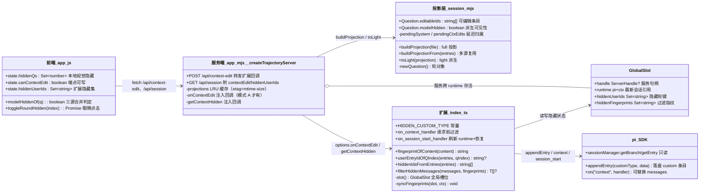
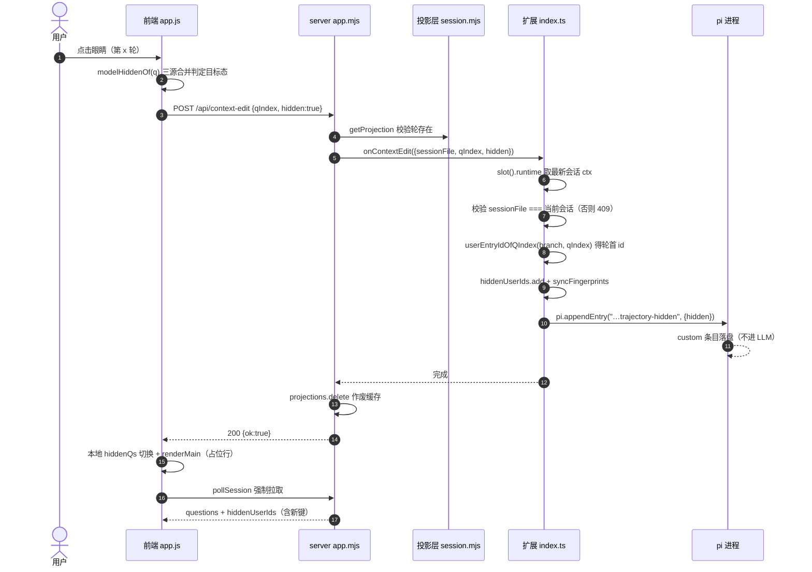
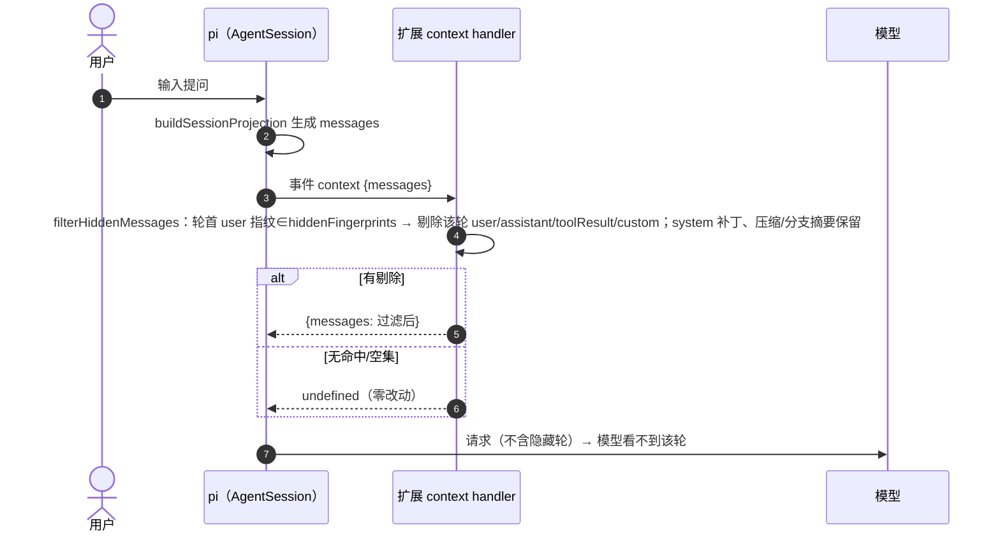
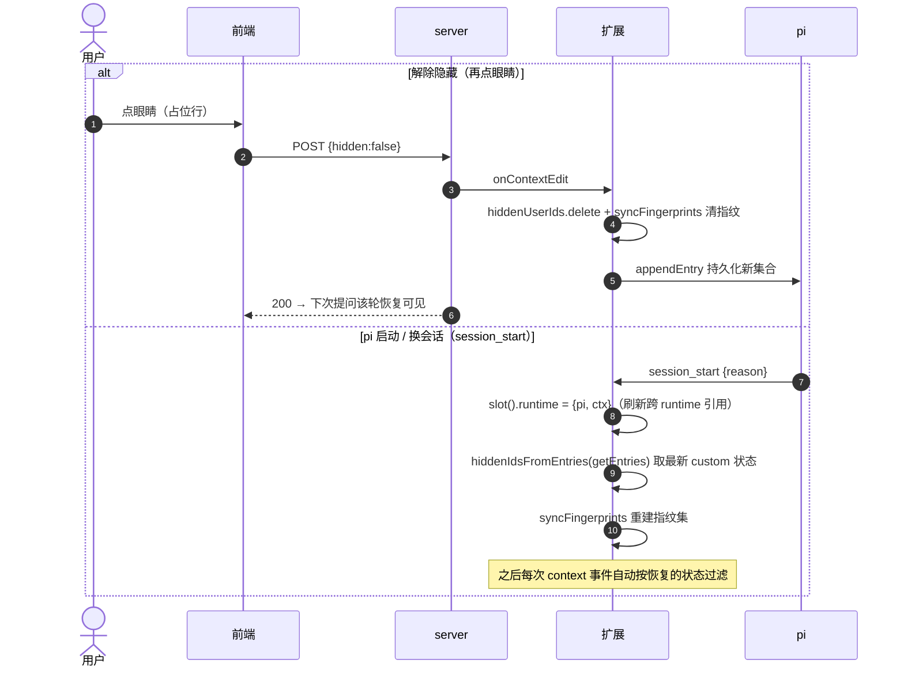

# 轨迹页「眼睛隐藏」联动模型上下文 — 设计说明

对应提交：`0bec7dd`（feat: 眼睛隐藏联动模型上下文）。

功能一句话：轨迹页点击眼睛隐藏某轮后，**下次提问时模型收到的上下文不含该轮**；再点眼睛（或重启 pi）后恢复可见。raw 会话文件永远不被改写——这是纯投影层的剔除，可逆、零风险。

## 1. 设计决策

| 候选方案 | 结论 | 原因 |
|---|---|---|
| 追加 `context_edit` 条目 | ✗ 放弃 | pi 扩展拿到的 `sessionManager` 是 `ReadonlySessionManager`（只有 get 系方法）；`appendContextEdit` 仅 pi 内部使用（错误恢复、回合边界草稿）。外部 `fs.appendFile` 写文件会与运行中 pi 的内存树产生平行分叉，不可行 |
| `pi.appendEntry`（custom 条目持久化）＋ `pi.on("context")`（请求前过滤 messages） | ✓ 采用 | 都是 pi 扩展官方 API：custom 条目不进 LLM 上下文、pi 负责落盘（重启/换会话可恢复）；context 事件每次 LLM 调用前触发，返回值可直接替换发送给模型的 messages，实时生效 |
| 投影层支持 `context_edit` 显示 | ✓ 保留（只读） | pi 自身会写 `context_edit`（如错误恢复剔除），轨迹页需正确聚合展示；轮级 `modelHidden` 也从它派生，与眼睛状态合并展示 |

隐藏状态的键是**轮首 user 条目 id**（稳定、不受分支/轮序变化影响）；过滤对齐用**轮首 user 的内容指纹**（context 事件的 messages 由投影重建，对象引用不稳定）。

## 2. 类图（模块视图）

JS 项目无真实类；类图表达模块成员与依赖，属性即状态、方法即函数。

## 3. 时序图

### 3.1 隐藏一轮（点击眼睛，模式 A 当前会话）

### 3.2 下次提问（过滤生效）

### 3.3 恢复（解除眼睛 / pi 重启 / 换会话）

## 4. 新增模块成员（"类"）

| 位置 | 成员 | 职责 |
|---|---|---|
| index.ts | `HIDDEN_CUSTOM_TYPE` | 隐藏状态 custom 条目类型名（`pi-chat-helper.trajectory-hidden`），最新一条生效 |
| index.ts | `EntryLike` | 会话条目最小结构类型（划轮/恢复/指纹只需 4 字段，测试可直接造对象） |
| index.ts | `fingerprintOfContent()` | 轮首 user 内容指纹：string 原样、块数组拼 text 块 |
| index.ts | `userEntryIdOfQIndex()` | 按投影同款规则划轮，取第 x 轮轮首 user entry id |
| index.ts | `hiddenIdsFromEntries()` | 从条目流恢复隐藏集（最新 custom 胜出） |
| index.ts | `filterHiddenMessages()` | 核心过滤：指纹命中整轮剔除对话消息，提示词状态保留；无命中返回 null |
| index.ts | `syncFingerprints()` | 全量重建指纹集（集合小，重建即可，不做增量） |
| index.ts | `GlobalSlot.runtime` | 最新 runtime 引用，session_start 刷新；server 回调经它取 ctx，跨会话不失效 |
| session.mjs | `Question.editableIds` | 轮内可被 context_edit 编辑的条目 id（收集时机在切轮**后**，见 §5） |
| session.mjs | `Question.modelHidden` | 轮级模型可见性派生（整轮剔除才标记，部分剔除不标） |
| app.mjs | `POST /api/context-edit` | 端点：501（无 handler）/400（参数、非 pi 源）/404（会话）/409（扩展拒绝）→ 200 |
| app.mjs | `getContextHidden` 选项 | server 组装 /api/session 时附 `hiddenUserIds`（仅扩展当前会话） |
| app.js | `modelHiddenOf()` | 前端三源合并判定（本地 ∪ 投影派生 ∪ hiddenUserIds） |
| app.js | `toggleRoundHidden()` | 眼睛点击：可写先 POST 成功再切视觉并强制拉取；只读退化纯 UI 隐藏 |
| app.js | `state.canContextEdit / hiddenUserIds` | 端点可写标记与扩展隐藏集，切会话/切源重置 |

## 5. 修改点清单

| 文件 | 修改 | 说明 |
|---|---|---|
| `trajectory-web/index.ts` | `slot()` 结构扩展 | GlobalSlot 增加 `runtime / hiddenUserIds / hiddenFingerprints`；初始化同步补齐 |
| `trajectory-web/index.ts` | `startInProcess()` 签名 | 新增第 5 参 `hooks`（onContextEdit / getContextHidden 稳定委托，内部经 slot 取最新 runtime） |
| `trajectory-web/index.ts` | `runStart()` | 构造 hooks：校验当前会话、划轮取键、更新集合、`appendEntry` 持久化 |
| `trajectory-web/index.ts` | `export default` | 注册 `session_start`（刷新 runtime＋恢复状态）与 `context`（过滤）事件 |
| `trajectory-web/server/session.mjs` | system 补丁延迟归属（前一提交） | 轮间 system 补丁归下一轮开头；本功能的 `pendingSystem` 机制与 `pendingCtxEdits` 共用 drain 钩子 |
| `trajectory-web/server/session.mjs` | context_edit 聚合 | 连续 `context_edit` 条目聚为一条「上下文编辑 ×N」事件；`rendersEvent` 排除 context_edit 自身（否则后续 edit 会把前一条冲刷成独立事件） |
| `trajectory-web/server/session.mjs` | editableIds 收集时机 | user 条目在 `newQuestion` **之后**收集（否则被推入上一轮）；assistant/toolResult 在 message 分支收集；custom_message 在自身分支收集 |
| `trajectory-web/server/session.mjs` | `lightEvent` context-edit case | 仅在顶层 `replacement` 为字符串时截断（聚合形态只有 `edits` 数组，避免把 undefined 覆盖成 ""） |
| `trajectory-web/server/app.mjs` | POST 白名单 | 放行 `/api/context-edit`（原先只放 translate） |
| `trajectory-web/server/app.mjs` | `/api/session` 响应 | 附 `contextEdit`（是否注入 onContextEdit）与 `hiddenUserIds`（文件匹配扩展当前会话才带） |
| `trajectory-web/web/app.js` | 眼睛点击重构 | 从同步切 Set 改为 `toggleRoundHidden()`（可写走 POST，失败 setSync 提示不切换） |
| `trajectory-web/web/app.js` | 轮渲染 | 隐藏判定 `hiddenQs ∪ modelHiddenOf(q)`；占位行 title 提示「（模型上下文已剔除）」 |
| `trajectory-web/web/app.js` | `pollSession` | 消费响应的 `contextEdit` / `hiddenUserIds` |
| `trajectory-web/web/app.js` | `selectSession` / `switchSource` | 三态（folded/selected/hidden + canContextEdit/hiddenUserIds）同步重置 |

## 6. 边界与降级

| 场景 | 行为 |
|---|---|
| 模式 B（`npm run dev` 独立服务） | 端点 501；眼睛退化为纯视觉隐藏（占位行无「模型已剔除」提示） |
| 模式 A 观察非当前会话 | 端点 409（扩展校验 `sessionFile` 与当前会话一致才写） |
| 起始组「会话开始」 | 不可隐藏（`qIndex < 0` 前端不发请求；端点 400） |
| Codex 源 | 端点 400（仅 pi 源支持） |
| 轮已被 compaction 替代 | 过滤无实际效果（重放时本就不进上下文），UI 不特殊处理 |
| pi 自身写入的 `context_edit` | 投影聚合展示 + `modelHidden` 派生，与眼睛状态合并显示，只读不可解除 |

## 7. 验证索引

- 单测：`tests/test-projection.cjs`（聚合/派生/整轮剔除）、`tests/test-extension.cjs`（四个纯函数 + 进程内集成链路 + 404/501）、`tests/test-server.cjs`（501）、`tests/test-web-lib.cjs`（守卫）
- 端到端：RPC 模式驱动 `pi -ne -e .`——轮 1 告知暗号 → 隐藏轮 0 → 轮 2 模型答「不知道」→ 解除 → 轮 3 答出暗号（验证记录见 ROADMAP 2026-11-04 条目）
