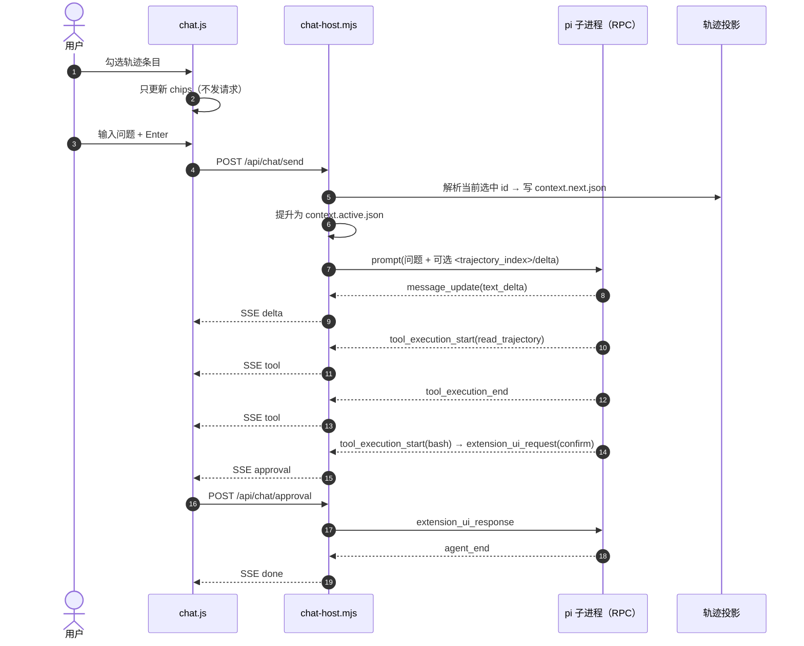

# 对话页面接 pi agent：方案总览

> 状态：方案已确认（v2：pi 子进程 + RPC + context-as-tool），实施中。实施完成后同步更新 `ROADMAP.md`。
> 关联文档：[api.md](api.md)（接口与存储契约）、[ui.md](ui.md)（交互与视觉）、[implementation.md](implementation.md)（逐文件落地清单）。

## 1. 现状

| 位置 | 现在是什么 | 与本次需求的关系 |
|---|---|---|
| `trajectory-web/web/app.js` | 侧边对话栏只有本地消息流：`state.chat` 存 `{role,text}`，`sendChat()` 只 push 进列表，不发请求；空态提示「未接入模型」 | 需要换成真实 pi agent |
| `trajectory-web/server/app.mjs` | 只读轨迹 HTTP 服务；POST 只开放 `/api/translate`、`/api/context-edit`、`/api/crop-entry`；没有 SSE | 需要新增对话路由、SSE、子进程管理 |
| `trajectory-web/index.ts` | 模式 A：在 pi TUI 进程内启动 viewer 服务，通过扩展回调写回当前会话 | 启动方式不变；新增 chat host |
| `trajectory-web/server/main.mjs` | 模式 B：独立 node 进程，只读 viewer，零依赖 | 同样新增 chat host；不 import pi SDK |
| 宿主 pi TUI | 用户正在用的编码 agent；扩展跑在它里面 | **不是** chat 的引擎；chat 是独立 pi 子进程 |

关键结论：

1. **现在没有「pi agent + web 服务」的 C/S 结构。** 模式 A 是 pi TUI 进程里挂一个 viewer 服务；模式 B 是纯只读 viewer。对话栏是纯前端假消息。
2. **viewer 不驱动任何 agent。** 轨迹页直接读 session JSONL；对话页需要新增「控制面 → pi 子进程」这条链路。
3. **chat 不再是问答器。** 它是一个真正的 pi agent（pi session、工具、技能、compaction、审批），壳只负责 HTTP/SSE、线程目录、上下文选择与 UI。

## 2. 目标

### 2.1 四条原始需求

| 编号 | 需求 | 方案 | 验收信号 |
|---|---|---|---|
| R1 | 从 pi 配置同步模型列表，斜杠选择模型 | chat 子进程的 `get_available_models` / `set_model`；线程模型由 pi session 记录 | `/model` 列表与 pi 内置选择器一致；切换后刷新/重启仍保持；响应不含密钥 |
| R2 | 参考 pi 导入技能的方式导入技能，斜杠选择技能 | chat 子进程 `get_commands` 过滤 `source === "skill"`；发送 `/skill:name` 由 pi 原生展开 | 技能列表与 pi 的 `/skill:` 一致；选中后请求里出现 pi 原生 `<skill>` 块；frontmatter 由 pi 处理 |
| R3 | 独立的对话目录，不出现在轨迹路径 | 子进程 `--session-dir <chatDir>/<source>/<safeSessionId>/sessions`；`chatDir` 默认 `<agentDir>/pi-chat-helper/chats` | 轨迹列表、`/api/sessions`、pi `/resume` 都看不到；删 chatDir 不影响轨迹 |
| R4 | 轨迹勾选作为上下文，可针对选中条目提问 | 选中集 → 每轮快照 + 清单；子进程加载 `read_trajectory` 工具，模型按需读取 | 勾选 3 条 → 清单 3 条；模型能引用选中内容；增删勾选下一轮生效 |

### 2.2 本次确认的额外要求

| 编号 | 要求 | 落点 |
|---|---|---|
| R5 | 不是问答器：真 agent、真会话、能调工具 | 每线程一个 pi 子进程；工具调用可见；会话可恢复 |
| R6 | 三档工具 profile 都做；默认只读；全量档逐次审批 | `no-tools`（仅 `read_trajectory`）/ `read-only`（默认）/ `full`（需审批） |
| R7 | 默认只加载全局技能；项目技能显式开关 | 默认 `-na`；开关打开时 `--skill <project skill dir>` 精确加载 |
| R8 | 每轨迹会话 1 个 child，全局最多 2，空闲 15 分钟回收，同项目串行 | chat host 进程池 + 项目级 turn 锁 |
| R9 | 启动方式不变：`/deepseek-trail start` / `npm run dev` | 用户不需要单独启动 agent；首条消息懒启动子进程 |
| R10 | 本地接口安全：Origin/Host、JSON content-type、路径与大小校验 | 所有 POST + chatDir/thread/skill 校验 |

### 2.3 非目标（v1 明确不做）

- **线程列表达成选择，不做重命名/删除 UI。** `/new` 新建 pi session；`/resume` 打开历史线程列表切回旧线程（复用 `switch_session`）。
- **不做多用户、鉴权、云端同步、远程访问。** 仍只监听回环地址。
- **不把 chat 注入宿主的 TUI 会话。** chat 永远是独立 pi 子进程，不污染你正在用的编码会话。
- **不做图片/语音/多模态输入。** 轨迹里的图片只记 `[图片×N]` 占位。
- **不做自动清理/配额。** 文档给出目录位置与手动清理方式。
- **不做 chat 派生 subagent、定时任务、后台队列。**
- **不做移动端专门布局。**

## 3. 关键决策

| # | 决策 | 理由 | 代价 / 边界 |
|---|---|---|---|
| 1 | chat 用 **pi 子进程 + RPC**，不在服务里 `streamSimple`，也不在进程内 `createAgentSession` | 真 agent；与 TUI 隔离；工具/技能/compaction/历史全由 pi 管；服务端不 import SDK | 进程生命周期管理；pi 版本契约；首次启动约 1 秒 |
| 2 | 线程 = **pi session**，用 `--session-dir` 落到 chatDir | 不自己维护 JSONL/版本/损坏行；`/resume` 扫默认 root，天然看不到 | 线程 id 是 pi session id；旧的自定义 `main`/时间戳 id 取消 |
| 3 | 上下文用 **context-as-tool**：清单 + `read_trajectory` 工具 | 不把整块轨迹每轮重发；模型按需取；长对话成本可控 | 模型可能不调用工具，需要好的系统提示；反选不抹除已读历史 |
| 4 | 模型与技能走 RPC（`get_available_models` / `get_commands`） | 与 pi 运行时完全一致；OAuth、provider compat、技能发现规则不用抄 | RPC 契约随 pi 版本变化，需要最低版本与契约测试 |
| 5 | 三档工具 profile：`no-tools` / `read-only` / `full`；默认只读 | 先给安全默认，再显式升级能力 | 切档要重启 child；全量档必须有审批 |
| 6 | 全量档审批 = 小扩展 + `RpcExtensionUIRequest` 桥 + 本会话允许 | 逐次确认；不把 shell 交给网页；可减少重复弹窗 | 浏览器断开/超时必须拒绝；允许集只在内存 |
| 7 | 项目信任默认关；项目技能显式 `--skill` | `--all` 看别人项目时不加载任意项目技能，降低提示注入风险 | 项目技能默认不在列表，需要用户手动打开 |
| 8 | 进程池：每轨迹会话 1 child，全局 2，空闲 15 分钟，同项目串行 | 常见场景只有 1 个；切会话不冷启动；避免同项目并发写 | 两个项目同时用时最多 2 个；第三个要等/回收 |
| 9 | viewer 双模式、启动命令、轨迹功能全部不变 | 本次是加法，不推倒重来 | chat 在模式 A 随 TUI 退出；长任务建议模式 B |

## 4. 架构

### 4.1 进程树

**模式 A（`/deepseek-trail start`，贴身查看）**

```text
浏览器 ──HTTP/SSE──> pi TUI 进程
                     ├─ 主 AgentSession（你在 TUI 里用的编码会话，不在 chat 链路上）
                     ├─ pi-chat-helper 扩展
                     │   ├─ question-panel
                     │   └─ viewer HTTP 服务（进程内，:7717）
                     │        └─ chat host ──spawn/stdio──> pi 子进程 × N
                     └─ 结束条件：/deepseek-trail stop、quit、/reload
```

**模式 B（`npm run dev`，常驻服务）**

```text
浏览器 ──HTTP/SSE──> node viewer 进程（:7788）
                     └─ chat host ──spawn/stdio──> pi 子进程 × N
                         结束条件：SIGINT / SIGTERM
```

要点：

- chat 子进程用 `--no-extensions` 启动，**不会加载 pi-chat-helper**，不会递归起第二个 viewer。
- 子进程只显式加载两个小扩展：`chat-trajectory-tool.ts`（上下文工具）、`chat-approval.ts`（仅全量档）。
- 子进程与 TUI 主会话是兄弟：只共享 `~/.pi/agent` 下的 auth/models/skills，不共享会话、不互相调用。

### 4.2 一轮对话时序



### 4.3 两条数据路径

| 数据 | 路径 | 说明 |
|---|---|---|
| 轨迹页 | viewer → 读 pi/codex session JSONL → `buildProjection` → `/api/*` | 不经过任何 agent，现有能力不变 |
| 对话页 | chat.js → chat host → child stdio（JSON lines） | 子进程自己写自己的 pi session 文件 |
| 对话历史 | `GET /api/chat/thread` → 读 chat session 文件 → 复用同一套投影 → 安全投影给前端 | 服务端不 import SDK，也能在 child 空闲/未启动时读 |

### 4.4 启动与能力探测

- **启动方式不变。** 模式 A：`/deepseek-trail start [端口] [--codex] [--all]`；模式 B：`npm run dev`。
- **agent 不用单独启动。** 打开对话栏只做 `GET /api/chat/capabilities`（找 pi 可执行文件、`pi --version`、chatDir 可写），不 spawn 常驻进程。
- **首条消息懒启动。** chat host 按 `source:sessionId` 建 child；后续消息复用；空闲回收。
- **pi 可执行文件解析顺序**：`PI_CHAT_PI_BIN` → 宿主 `process.execPath` + `process.argv[1]`（模式 A，保证同版本）→ `@earendil-works/pi-coding-agent/rpc-entry` → `~/.pi/agent/bin/pi` → PATH 的 `pi`。
- **失败降级**：`capabilities { enabled:false, reason }`，对话栏禁用；轨迹功能完全不受影响。
- **关闭顺序**：`chatHost.close()`（abort + SIGTERM→SIGKILL 全部 child）→ 关 HTTP server。

## 5. 四条需求的落点

### 5.1 模型

- 列表：`get_available_models`，服务端裁成 `provider/providerName/id/name/reasoning/contextWindow/maxTokens`，不含 apiKey/baseUrl/headers。
- 当前：`get_state().model`；线程持久化由 pi session 的 model 条目承担。
- 切换：`set_model`；流式中 409；切换后前端更新 chip，写一条 notice（UI 层，不额外写业务文件）。
- 斜杠：`/` → 命令层 → `/model` → 面板；按 provider 分组，当前项打勾。
- 刷新：打开面板带 `refresh=1`，服务端调 `get_available_models`（pi 自己决定是否走网络）。

### 5.2 技能

- 列表：`get_commands` 过滤 `source === "skill"`；`name` 去掉 `skill:` 前缀展示；`sourceInfo.path/scope/origin` 映射。
- 选择：面板选中 → chip；发送时把 `/skill:name` 拼进 prompt，**展开由 pi 完成**（不复制 `<skill>` 格式）。
- 直接输入：`/skill:name args` 原样发送，pi 找不到就按 pi 行为原样透传。
- 项目技能：默认 `-na`，只列全局技能；抽屉里的「使用本项目技能」开关打开后，spawn 参数追加 `--skill <project skill dir>`，并重启 child。
- 大小守卫：选中时读 `SKILL.md` 的字节数/字符数；超过 32k 字符提示确认，超过 200k 字符拒绝发送。原因：pi 展开后壳无法再截断，单条超大消息可能直接超出 provider 窗口。
- `disable-model-invocation` 由 pi 处理；列表里的「仅手动」徽标属于可选展示，不影响发送。

### 5.3 对话目录

```text
<chatDir>/<source>/<safeSessionId>/
├── sessions/                      # pi session 文件（--session-dir）
│   ├── 20261105T090000-abc.jsonl
│   └── ...
└── meta/
    ├── context.active.json        # 本轮生效的选中集快照
    ├── context.next.json          # 勾选变化先写这里
    └── turns.jsonl                # 每轮 displayText / contextRefs / skill / profile
```

- `chatDir` 默认 `<agentDir>/pi-chat-helper/chats`；`agentDir` 尊重 `PI_CODING_AGENT_DIR`；模式 B 可用 `--chat-dir`。
- 启动校验：`chatDir` 不得位于 `sessionsRoot` / `codexRoot` 下；否则对话禁用。
- 目录 `0700`；pi 自己写 session 文件，壳只写 `meta/`。
- **不放进 `~/.pi/agent/skills`**：pi 会递归扫描技能目录，混入 session 没有意义，也容易被 `/reload`/备份逻辑带上。
- 「新对话」= `new_session` 或带 `--session-id` 新建；旧 session 保留，可按 id 恢复；v1 不做自动清理。

### 5.4 上下文（context-as-tool）

- **选中集**：轨迹列表 checkbox 仅在蒸馏模式显示；存 `tw.chatCtx`，不限制条数；chat 模式 chips 可删不可加。
- **快照**：勾选变化写 `context.next.json`；每次 `prompt` 前原子提升为 `context.active.json`。流式期间改选择 → 下一轮生效。
- **清单**：系统提示只放规则；`<trajectory_index>` 放在当轮 user 消息里，首次全量、变化时发 delta + 新清单、未变化不发。工具 `read_trajectory({action:"list"})` 可随时重新拉清单。
- **读取**：`read_trajectory({action:"read", ids?, query?, kind?, offset?, limit?})`，只允许读当前选中集；单条 6k 字符、单次总量 12k 字符，超出给 offset 继续。
- **增删语义**：
  - 加 4/5/6 → 下一轮清单出现、工具可读；
  - 反选 2/3 → 下一轮清单消失、工具拒绝读取；
  - **已经读过的工具结果仍在 pi session 历史里，无法抹除**；要彻底“失忆”只能新开线程。
- **成本**：清单 1–2k 字符，只在变化时发；正文按需取；pi 的 compaction 兜历史溢出。
- **与裁剪/隐藏的关系**：对话上下文是独立快照；剪刀/眼睛只影响宿主 pi 的模型上下文，不影响 chat。取消勾选即可让 chat 下一轮看不到某条。

## 6. 分阶段实施

| 阶段 | 交付 | 预估 | 验证 |
|---|---|---|---|
| T0 文档 | 本目录四份文档重写到 v2 | 0.5 天 | 文档间无旧实现残留；每条需求有落点 |
| T1 骨架 | `pi-binary.mjs`、`chat-host.mjs` JSON line 协议、capabilities、假 child 测试 | 1 天 | 真 `pi --mode rpc` 冒烟能 prompt/abort |
| T2 线程 | 线程=pi session、GET/POST thread、chatDir 守卫、投影映射 | 1 天 | 文件只落 chatDir；重启可恢复；`/resume` 看不到 |
| T3 对话 | send/stop SSE、工具事件、前端流式与去重 | 2 天 | 真子进程流式出字；停止/崩溃/刷新有 UI |
| T4 模型 | models/model 路由、`/model` 面板 | 1 天 | 列表与 pi 一致；切换持久化；无密钥泄漏 |
| T5 技能 | skills 路由、`/skill` 面板、原生展开、大小守卫、项目技能开关 | 1 天 | 列表一致；`<skill>` 块出现；开关生效 |
| T6 上下文 | 勾选/chips、快照、清单/delta、`read_trajectory` 工具、turns 侧车 | 1.5 天 | 勾选→清单→模型引用；增删下一轮生效 |
| T7 工具审批 | 三档 profile、审批扩展、RPC UI 桥、本会话允许、同项目串行 | 2.5 天 | 全量档逐次确认；拒绝不执行；并发被拒 |
| T8 进程池 | 池上限/回收/切线程/切项目、双模式启动接线、孤儿防护 | 1 天 | 进程数符合预期；A/B 都能起；无残留 |
| T9 安全 | Origin/Host、JSON content-type、路径/大小校验、错误映射 | 0.5 天 | 安全用例全过；禁用态不报错 |
| T10 收尾 | 测试、README/ROADMAP、手工冒烟、分层 commit | 1.5 天 | 全套测试 + tsc + `pi -ne -e .` + dev 冒烟 |

总预估约 13–14 个工作日；T7 是唯一可能翻倍的部分。

## 7. 风险与限制

| 风险 | 影响 | 缓解 |
|---|---|---|
| RPC 契约随 pi 升级变化 | 事件/命令不兼容 | 记录最低 pi 版本；capabilities 探测版本；真 RPC 契约测试；只依赖 `prompt/abort/set_model/get_*` 稳定子集 |
| 子进程孤儿/泄漏 | 端口、CPU、内存 | 父进程 close 时 SIGTERM→SIGKILL；stdin EOF 双保险；测试断言无残留 |
| OAuth / `auth.json` 并发刷新 | 模式 A 的 TUI 与 chat child 同时刷新 token | 复用同一 agentDir；捕获凭证同步错误并提示；长任务优先用模式 B |
| 全量工具 = 真能改仓库 | 误删/误改文件 | 默认只读；全量档逐次审批；拒绝/超时即不执行；同项目串行 |
| 提醒注入（轨迹/工具结果） | 模型把资料当指令 | 系统提示声明资料非指令；全量档写操作审批；默认只读 |
| 反选不抹历史 | 模型仍能引用早前读过的内容 | 文档声明；UI 提供「从当前选择新开对话」；不承诺编辑历史 |
| 上下文工具不被调用 | 模型凭空回答 | 工具描述 + 系统提示明确「先 list 再 read」；清单里给 id/preview |
| 单条技能过大 | 一次请求超窗 | 32k 警告、200k 硬拒绝；提示用户拆分技能 |
| 同项目并发工具 | 文件竞态 | 项目级 turn 锁；第二个请求 409 |
| 模式 A 随 TUI 退出 | 长任务被杀 | 文档明确；长任务用模式 B |
| 项目技能 = 第三方 prompt | 提示注入/越权 | 默认 `-na`；显式开关；只加载用户选中的技能目录 |
| 模型列表为空/过期 | `/model` 不可用 | capabilities 给配置指引；保留上次成功列表；`refresh=1` 手动刷新 |
| 旧线程切换 | 改了 `/new` 后回不去 | `/resume` 列表 + `POST /api/chat/resume` 复用 `switch_session`；不做重命名/删除 |

## 8. 已确认的决定

1. chat 是 pi 子进程（RPC），不是 `streamSimple`，也不是进程内 `AgentSession`。
2. 线程 = pi session；对话目录默认 `<agentDir>/pi-chat-helper/chats`，可用 `--chat-dir`。
3. 上下文用 context-as-tool：清单 + `read_trajectory` 工具；不做全量注入。
4. 三档工具 profile 都实现；默认 `read-only`；全量档逐次审批。
5. 审批支持「本会话允许」：host 侧按项目 + 工具名记内存，服务重启失效。
6. profile 与项目技能开关按项目存储（`<chatDir>/settings.json`）；切档重启 child。
7. 项目技能默认不加载；开关打开时用 `--skill <dir>` 精确加载。
8. 进程池：每轨迹会话 1 child，全局 2，空闲 15 分钟，同项目串行。
9. 启动方式不变；chat agent 首条消息懒启动；模式 A 随 TUI 退出，模式 B 常驻。

## 9. 文档索引

- [api.md](api.md)：HTTP/SSE 契约、RPC 映射、存储结构、context-as-tool 细节、校验与安全。
- [ui.md](ui.md)：布局、输入卡状态、斜杠面板、模型/技能/上下文交互、/resume 线程历史、工具卡片、审批弹层、键盘与可访问性。
- [implementation.md](implementation.md)：逐文件改动、chat host、两个子进程扩展、前端依赖注入、测试清单、提交拆分与回滚。
