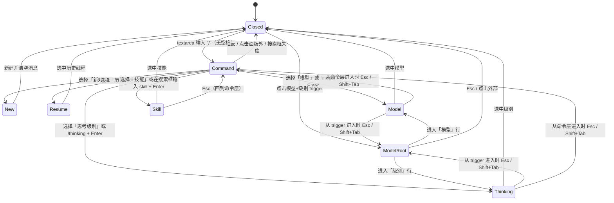

# 对话页交互与视觉方案（v2）

> 上游总览：[README.md](README.md)。接口契约：[api.md](api.md)。落地清单：[implementation.md](implementation.md)。
> 本版对话由 pi 子进程驱动：消息、工具调用、审批、模型与技能都来自 pi；壳只负责选择与展示。

## 1. 布局

### 1.1 现有结构

```text
#layout
├── #agent-rail          轨迹源选择
├── #sidebar             会话列表
├── #main                轨迹主区
└── #chat-drawer         对话栏（分屏，右侧）
    ├── #chat-resize     左缘调宽
    ├── #chat-list       消息流
    └── .chat-composer
        ├── #composer-resize  上边调高
        └── .chat-card
            ├── #chat-input   textarea
            └── .chat-row     #chat-send
```

### 1.2 新增结构

```text
#chat-drawer
├── #chat-resize
├── #chat-list                 消息流（user / ai / tool / notice）
├── .chat-composer
│   ├── #composer-resize
│   └── .chat-card
│       ├── .chat-overlay-anchor
│       │   ├── #chat-palette          斜杠/模型/技能/历史菜单（挂在卡片上方）
│       │   └── #chat-profile-menu     工具权限菜单（同锚点，隐藏）
│       ├── .chat-accessory
│       │   ├── #chat-context          上下文 chips
│       │   └── #chat-skill            技能 chip
│       ├── .chat-scroll > .chat-grow > #chat-input
│       └── .chat-row
│           ├── .chat-tools
│           │   ├── #chat-add          + 按钮（打开 Command 层）
│           │   └── .chat-modes
│           │       └── #chat-profile  权限 select（仅对话 / 只读 / 全量）
│           └── .chat-trailing
│               ├── .chat-standard-controls
│               │   └── #chat-model-label  模型+级别 trigger（模型名 + 级别 + chevron）
│               └── #chat-send        发送/停止二态
└── #chat-approval             审批弹层（覆盖抽屉内容，不阻塞轨迹区）
```

### 1.3 布局草图

```text
┌ 轨迹观察 ─────────────────────────────────────────── [主题] [对话] ┐
│ π │ 会话        │ 轨迹主区                          │ 对话        │
│   │ 会话 A      │                                   │ [+] [只读▾] [GLM-5.3▾] [↑]│
│   │ 会话 B      │  第 1 轮  ▾                       │             │
│   │             │   [x] 提问  帮我改…               │  用户气泡    │
│   │             │   [x] 工具  bash …                │  AI 回答     │
│   │             │   [ ] 回答  已完成                │  [工具卡片]  │
│   │             │                                   │             │
│   │             │                                   │ 上下文 2    │
│   │             │                                   │ [提问·…][工具·…]│
│   │             │                                   │ ┌─────────┐ │
│   │             │                                   │ │ /model… │ │
│   │             │                                   │ └─────────┘ │
└─────────────────────────────────────────────────────────────────┘
```

- 对话栏宽度、输入区高度沿用现有两个拖拽把手。
- 无顶部对话头；`.chat-row` 左起 `+`、权限 trigger，右侧模型+级别 trigger 与发送按钮。
- 上下文/技能 chips 在 `.chat-accessory`，横向可滚，最多一行，高度约 28px。
- `+` 不贴边：`.chat-row` 使用 space-between + 左右 8px padding；菜单锚点 `.chat-overlay-anchor` 贴在卡片顶部。

## 2. 对话头与输入卡状态

v1 **不设顶部对话头**。当前模型和工具权限都在输入卡底部 `.chat-row`，与发送按钮同排；顶部只保留抽屉开关（页面顶栏）。

```text
... 消息流 ...
┌─────────────────────────────────────┐
│ 问问这条轨迹…                      │
│ [+] [只读▾]       [GLM-5.3 max▾] [↑] │
└─────────────────────────────────────┘
```

- `+` 按钮（`#chat-add`）打开与 `/` 相同的 Command 层；不另做菜单。
- Command 层菜单外壳挂在 `.chat-card` 的 `.chat-overlay-anchor` 上，向上弹出：`bottom: calc(100% + 4px)`、左右贴齐卡片；权限/模型菜单按各自 trigger 锚定，见 §2.1 的定位表。
- 打开菜单后焦点仍在 `#chat-palette-search`；textarea 草稿不被清空。

### 2.1 模型 + 思考级别 trigger

- 位置：`.chat-row > .chat-trailing > .chat-standard-controls`，在发送按钮左侧；权限 trigger 在 `+` 右侧。
- 外观：dsh ModelSelect / PermissionSelect 的 trigger，不是遗留 `.select`：`inline-flex`、`gap:4px`、`height:28px`、`padding:0 4px 0 8px`、`border-radius:var(--dsw-radius-sm)`、透明底、13/20。
- 内容顺序：模型名（`label-secondary`，13/20/400）→ 级别（`label-caption`，13/20/400）→ 右侧 chevron（真实 SVG，12px，`label-caption`）。
- 空间不足时：`.triggerEffort` `flex-shrink:1000`，先省略级别；模型名随后省略；chevron `flex:0 0 auto` 不缩。
- 来源：模型取当前线程；新对话取 `<agentDir>/settings.json` 的 `defaultProvider/defaultModel`。级别取 `thread.thinkingLevel`（child `get_state().thinkingLevel` 优先，否则 settings `defaultThinkingLevel`）；都不为此 spawn。
- 文案：模型加载中显示「读取模型中…」，无模型显示「默认模型」；级别直接用 pi 原始 `off/low/medium/high/max`，不翻译；`title` 给模型/级别完整值。
- 点击 trigger 打开 **modelRoot** 层，两行：`模型  <当前模型>  ›`、`级别  <当前级别>  ›`。
- 进入 model 行 → 现有 Model 列表（按 provider 分组，当前项 ✓）；进入 effort 行 → Thinking 列表（当前项 ✓）。
- Esc / Shift+Tab：从 Model/Thinking 先退回 modelRoot，再关闭并回 trigger；从命令层进入的 Model/Thinking 仍回命令层（保留 `/model`、`/thinking` 快捷路径）。
- 流式中点击 trigger、`/model` 或 `/thinking`：提示「回复中，先停止」，直接返回。
- 模型 trigger 的 `aria-expanded` 覆盖 modelRoot/Model/Thinking 三层。

#### 菜单定位（Command / 权限 / 模型）

`/`、`+` 打开的命令层以及 skill/resume 子层保持卡片全宽；权限、模型菜单**不复用**这个位置，而是各自锚到 trigger。三套菜单的外观（`radius-lg`、`--dsw-menu-surface-fill`、`--dsw-menu-backdrop-filter`、`--dsw-elevation-prominent`、无边框）一致，只有定位不同。

| | `/` Command 层（不改） | 权限按钮 | 模型 trigger |
|---|---|---|---|
| 定位基准 | `.chat-overlay-anchor`（卡片顶） | 权限按钮 | 模型 trigger |
| 水平 | `left:0; right:0` | 左边缘 = 按钮左边缘 | 右边缘 = trigger 右边缘 |
| 垂直 | `bottom: calc(100% + 4px)` | 底边在按钮顶边上方 4px | 底边在 trigger 顶边上方 8px |
| 宽度 | 卡片全宽 | `fit-content`，min 144 / max 360 | `fit-content`，min 240 / max 420 |
| 视口限 | — | `min(…, calc(100vw - 24px))` | `min(…, calc(100vw - 24px))` |
| 最大高度 | 400px | `min(400px, 按钮上方可用空间)` | `min(400px, trigger 上方可用空间)` |
| z-index | 100 | 100 | 100 |

- 左右对齐方向跟着 trigger 在行内的位置走：权限在 `.chat-tools`（靠左），所以从按钮左边缘向右长；模型在 `.chat-trailing`（靠右），所以从 trigger 右边缘向左长。
- 4px 与 8px 不是笔误：权限菜单走通用 `MenuSurface`/portal，向上翻转用 `anchor(top) + 4px`；模型菜单走 ModelSelect，用 `anchor(top) + 8px`。
- 不用 CSS anchor positioning：`.chat-row` 的 `container-type: inline-size` 会建立包含块，令其后代的 `position: fixed` 相对 `.chat-row`；且 trigger 在 DOM 中晚于 `.chat-overlay-anchor`，不满足 anchor 元素先出现的要求。实现上用 JS 读取 `getBoundingClientRect()`，把 trigger 坐标换算到 `.chat-overlay-anchor` 的绝对定位坐标系，菜单仍为 `position: absolute`。
- 换算公式：`bottom = anchor.bottom - trigger.top + offset`；权限 `left = trigger.left - anchor.left`；模型 `right = anchor.right - trigger.right`。宽度写 `fit-content` 与 min/max；高度取 `min(400px, max(120, trigger.top - offset - 12))`。
- 打开后量一次菜单宽度，若左对齐时右边缘或右对齐时左边缘超出视口 12px，用 `left/right` clamp 回 12px 边距内。
- modelRoot / Model / Thinking 共用同一个 `#chat-palette` 元素，切层不重建容器；每次切层、窗口 resize、对话区滚动时重算，因此位置和宽度不跳变。
- 关闭菜单或回到 Command 层时清除内联定位，恢复 `left:0; right:0; bottom:calc(100% + 4px)`；`/` 层位置不退化。
- 权限/模型菜单会盖住卡片上部内容（包括 textarea 区域）：trigger 在卡片底部行，菜单底边又钉在 trigger 上方，这是 dsh 的预期行为，不是裁剪或定位 bug。

### 2.2 工具权限 trigger

- 位置：`.chat-row > .chat-tools > .chat-modes`，紧挨 `+` 按钮右侧；菜单 `#chat-profile-menu` 独立锚定到该按钮，左边缘对齐、底边在按钮顶边上方 4px（见上表）。
- 外观：dsh PermissionSelect trigger（`inline-flex`/gap4/28px/padding 0 4px 0 8px/radius-sm/透明底）；右侧 chevron 为真实 SVG；有 `triggerIcon` 时窄容器可只留图标。
- 三态：`仅对话`（no-tools）/ `只读`（read-only，默认）/ `全量`（full）。
- 点击：弹出小菜单，列出三档与一句说明：
  - 仅对话：只读轨迹工具，不能读项目文件。
  - 只读：可读项目文件（read/grep/ls），不能写、不能跑命令。
  - 全量：可写文件、可跑命令；每次执行前弹审批。
- 切档：`POST /api/chat/settings`；成功后 toast「对话进程已重启」；若流式中则先提示停止（409）。
- `全量` 开态用警示色（与裁剪/蒸馏的配色区分），`title` 说明「会真实修改工作区」。

### 2.3 新对话（/new）

- `+` 按钮打开命令层；命令面板仍提供「新对话」/`/new`，二者不是两套菜单。
- 选中即调用现有 `POST /api/chat/thread`，不新增接口。
- 不弹确认；新线程清空消息与上下文选择，模型/profile 保留。
- 流式中提示先停止；成功返回新 `threadId` 后写入 `localStorage["tw.chatThread"]["<source>:<sessionId>"]`。
- 关闭仍走顶栏对话按钮 / Esc，不在输入卡放关闭按钮。旧线程用 `/resume` 找回。

## 3. 斜杠面板

### 3.1 状态机



- 触发条件：textarea 输入值 trim 后匹配 `^/[A-Za-z]*$`（`/` 开头、没有空格），或点击 `.chat-tools` 的 `#chat-add`（始终打开 Command 层）。这只是**触发器**：textarea 的草稿不被读取为搜索词，也不被清空；`/model`、`/skill` 等文本也不会自动过滤，过滤词在搜索框里输入。
- `/skill:foo args` 有冒号/空格，不触发面板，直接按普通输入发送，由 pi 原生展开。
- 面板顶部是独立的搜索输入 `#chat-palette-search`（`.chat-palette-head` 内的 `type=search`），列表项在下方 `#chat-palette-list`。
  - 打开面板时搜索框清空并立即 focus；不再从 textarea 读取查询，也不需要剥前导 `/`。
  - Command 层过滤 `new`、`resume`、`model`、`thinking`、`skill`；Model/Thinking/Skill/Resume 层过滤对应列表。
  - 切层清空搜索框并保持搜索框焦点。
  - 选择项后关闭面板，焦点回 textarea；model/skill 选择清空触发用的 `/` 草稿。
  - Esc：子层回到 Command 层并清空搜索；Command 层关闭面板，焦点回 textarea 并恢复进入面板前的草稿。
  - 点击面板外或点击 textarea（搜索框失焦）关闭面板，不抢回焦点；textarea 保留/恢复草稿。
- 定位：`.chat-composer` 内 `position:absolute; left:10px; right:10px; bottom:calc(100% + 6px)`；`max-height:min(280px,50vh)`，搜索行固定，列表内部滚动。
- 层级：高于消息流，低于页面顶栏/审批弹层；点击面板外关闭。

### 3.2 外观

```text
┌─────────────────────────────────────┐
│ 搜索模型…                          │  ← #chat-palette-search（独立输入，顶部固定）
├─────────────────────────────────────┤
│ 模型                                │  ← 分组标题（按 provider 分组）
│  ✓ GLM-5.3        litellm           │
│    DeepSeek V4    litellm  推理 1M  │
│    Claude Sonnet  anthropic         │
├─────────────────────────────────────┤
│ 技能                                │
│    trajectory-web-maintenance       │
│    维护 trajectory-web 轨迹观察服务 │
└─────────────────────────────────────┘
```

- 菜单外壳：`border-radius: var(--dsw-radius-lg)`、`background: var(--dsw-menu-surface-fill)`、`backdrop-filter: var(--dsw-menu-backdrop-filter)`、`box-shadow: var(--dsw-elevation-prominent)`，无边框；列表容器 padding 4px。
- 菜单位置：Command 层（以及 skill/resume 子层）使用 `.chat-overlay-anchor` 挂在 `.chat-card` 顶部，菜单 `bottom: calc(100% + 4px); left:0; right:0; z-index:100; max-height:400px; overflow:hidden`；权限/模型菜单按 trigger 锚定，见 §2.1 定位表。
- 每行（`.chat-palette-item`）：`min-height:34px`、`padding:6px 8px`、`border-radius: var(--dsw-radius-md)`、13/20；高亮/键盘选中用 `--dsw-alias-interactive-bg-hover`，不用选中蓝。
- 分组标题（`.chat-palette-group`）：`padding:6px 8px`、11/15、`--dsw-alias-label-tertiary`。次文本（`.chat-palette-hint`）：右对齐、12/18、单行省略。
- 顶部搜索行固定：`.chat-palette-head` 包 `#chat-palette-search`；下方 `#chat-palette-list` 单独滚动。
- Thinking 层：搜索框 placeholder 为「搜索级别…」，每行显示原始 level；当前项左侧 `✓`；无结果「没有匹配的思考级别」。
- 每行：主文本 + 次文本；当前项左侧 `✓`。
- 空结果：搜索词把非空列表过滤空时显示 `没有匹配的模型` / `没有匹配的技能`；模型列表本身为空且无错误时给配置指引「pi 没有可用模型，先在 models.json / 登录里配置」。`modelsError` 只作为单独错误行，不参与空态判定。
- 新对话尚未落盘（虚拟线程）时模型面板照常可用，不因线程文件不存在报错。

### 3.3 键盘

| 键 | Command 层 | modelRoot 层 | Model/Thinking/Skill 层 | 面板关闭时（textarea） |
|---|---|---|---|---|
| `↑` / `↓` | 移动高亮 | 移动高亮 | 移动高亮 | 无 |
| `Enter` | 进入子层 / 选择命令 | 进入 Model/Thinking | 选中并关闭 | 发送消息 |
| `Tab` | 同 Enter（可选） | 同 Enter（可选） | 同 Enter（可选） | 切换焦点 |
| `Esc` | 关闭面板，焦点回 textarea，恢复草稿 | 关闭面板，焦点回 trigger | 从 trigger 进入回 modelRoot；从命令层进入回 Command | 走现有 Esc 链 |
| `Shift+Tab` | 关闭面板 | 关闭面板 | 回上一层（modelRoot 或 Command） | 切换焦点 |
| `Shift+Enter` | 无 | 无 | 无 | 换行 |

- 搜索框打开即 focus；textarea 在面板打开时不接收搜索输入。
- IME 组合中（`e.isComposing`）不处理 Enter；搜索框与 textarea 的 keydown 都要判断。
- 面板打开时 Enter 不发送消息；先在搜索框/textarea 的 keydown 里判断面板状态。

## 4. 模型与思考级别选择

### 4.1 模型

1. 输入 `/` 或点击 `#chat-add` → Command 层。
2. 选「模型」、点击模型控件或 `/model` + Enter → `GET /api/chat/models?refresh=1`，显示 loading 行。
3. 列表到达 → 按 provider 分组；只显示「显式配置集」里的 provider：`<agentDir>/models.json` 的 `providers` 键，或 `<agentDir>/auth.json` 中有有效登录条目的 provider。仅因环境变量凭据被 pi 目录带出的 provider（如 anthropic/zai）不显示；当前线程模型打勾。当前模型优先显示在列表首位并打勾；不在配置集合里也补首位。
4. 选中 → `POST /api/chat/model`；成功后更新输入卡模型 trigger、关闭面板、插入居中 notice `已切换到 GLM-5.3`。
5. 失败 → 面板内错误行，保持打开；不改模型 trigger。

展示：

- 主文本：`model.name || model.id`。
- 次文本：`${provider}${reasoning ? " · 推理" : ""}${contextWindow ? " · " + fmtContextWindow(contextWindow) : ""}`。
- 当前项左侧勾，行背景保持普通。
- 搜索匹配 `name/id/provider/providerName`；多词 AND。
- 每次打开带 `refresh=1`；前端 5 秒内重复打开复用缓存。

### 4.2 思考级别

1. 点击模型+级别 trigger → modelRoot → 「级别」行；或 Command 层选「思考级别」，或 `/thinking` + Enter → Thinking 层。
2. `GET /api/chat/thinking?source&session[&thread]` 返回 `{ level, levels }`；无 child 时服务端读 settings.json / 回落后端默认 levels，不 spawn。
3. 列表按原始 level 展示（`off/low/medium/high/max`），当前项打勾；搜索框过滤 level。
4. 选中 → `POST /api/chat/thinking`；成功就地更新 trigger 的级别段并插入 notice；失败在面板内显示错误。
5. 流式中 409 / 前端先提示「回复中，先停止」；不重启 child。

## 5. 技能选择

### 5.1 流程

1. `/` → Command 层 → 「技能」。
2. `GET /api/chat/skills`；首次/切会话带 `refresh=1`，同一会话用 60 秒缓存（服务端）。
3. 面板按 scope 分组：用户、项目、包、路径；`scope` 缺失归到「其它」。
4. 选中 → 不立即请求，只显示技能 chip：
   ```text
   [ 技能：trajectory-web-maintenance  × ]
   ```
5. 发送时前端带 `skill: name`；服务端拼 `/skill:<name>` 前缀，pi 原生展开。
6. 发送成功 → chip 清除；失败 → chip 保留。
7. 再次 `/skill` → 替换当前 chip；一次只挂一个技能。

### 5.2 项目技能开关

- 技能面板顶部一行开关：`使用本项目技能`，默认关闭。
- 关闭时：只列全局技能（child 用 `-na`）。
- 打开时：`POST /api/chat/settings {projectSkills:true}` → 重启 child 并带 `--skill <projectPath>/.pi/skills`、`--skill <projectPath>/.agents/skills`（存在才加）。
- 开关按项目持久化；`title` 说明「会加载该项目的技能文件，可能包含第三方提示词」。

### 5.3 大小守卫与徽标

- 技能行次文本右侧显示 `chars` 量级（如 `1.8k`）；`> 32k` 用警示色。
- 选择超大技能时弹确认：`技能正文 236k 字符，可能超出上下文，仍要发送？`
- `> 200k` 直接禁用该行，`title` 说明「过大，请在 SKILL.md 里拆分」。
- `disableModelInvocation` 的技能仍可手动选择；行尾显示 `仅手动` 灰字。
- 列表为空：`pi 没有发现技能（检查 ~/.pi/agent/skills 或项目 .pi/skills）`。

### 5.4 直接输入

- `/skill:name args` 回车：不经过面板，服务端做大小守卫后原样发送；找不到技能按 pi 行为透传。
- `/skill` 后 Enter：进入技能列表，不发送。

## 6. 线程历史（/resume）

- 命令面板新增「历史对话」/`/resume`；打开独立 resume 层，不新增线程列表按钮。
- 数据：`GET /api/chat/threads?source=&session=`；按 mtime 倒序，最多 50 条；跳过超过 32MB 的文件。
- 每项展示：首条用户消息摘要（截断）、时间、模型名、用户轮数；当前线程左侧 `✓`。
- 空态：`还没有历史对话`。加载失败单独错误行，不影响命令层。
- 选中后：`POST /api/chat/resume` 复用 `switch_session`，不新建线程；成功后更新 `tw.chatThread`、消息列表与 `#chat-context` chips。
- 键盘与模型/技能层一致：搜索框 ↑↓ 高亮、Enter 选中、Esc 回 Command 层；搜索框独立，textarea 草稿不动。
- 边界：流式中 409；线程文件已被删 404；同项目有活动 turn 时 409。

```text
┌────────────────────────────────────┐
│ 搜索历史对话…                       │
├────────────────────────────────────┤
│ 历史对话                            │
│  帮我看看这个报错      10:24 · 3 轮 │
│  GLM-5.3                            │
│ ✓ 模型切换失败        09:12 · 1 轮 │
└────────────────────────────────────┘
```

## 7. 上下文管理

### 7.1 勾选框显示条件

- 显示：**仅蒸馏模式开启**。对话栏打开不再显示行级/轮次 checkbox。
- 隐藏：蒸馏关闭（包括 chat 打开时）。
- 实现：`selectMode = distillMode`；`renderEvent`/`renderMain` 用 `selectMode` 控制 `.ev-check`/`.q-check` 与 `no-select` 网格列。
- 进入/退出蒸馏模式不改变 `state.selectedEvs` 或 `tw.chatCtx`；chat 打开/关闭只切换可达性。
- chat 模式下 chips 仍可 `×` 删除，但页面上没有新增 checkbox；要新增必须进入蒸馏模式。

### 7.2 交互

- 行级 checkbox：勾选/取消该事件；点击不展开详情。
- 轮次头 checkbox：全选/取消全选本轮所有事件（含折叠、被过滤的）；三态 `all/some/none`。
- 勾选后：
  - `#chat-context` 立即出现 chip；
  - 写 `localStorage["tw.chatCtx"]`；
  - 不触发网络请求。
- 取消/清空：同步移除 chips 与存储；不影响已发送的历史。
- 不限制条数；选中集可超过 200 条。勾选时不做静默截断。
- 切会话/切源：按 `source:sessionId` 保存/恢复。

### 7.3 增删语义（context-as-tool）

- 勾选变化只影响**下一轮**；流式中的请求使用发送时的快照。
- 清单不因条数报错：前 80 条带 preview，之后压成 `- [id] label` 短行；超过清单文本预算时追加「…还有 K 条，用 read_trajectory list 查看」。
- `read_trajectory` 的 `list` 支持 `offset`/`limit` 分页；默认每页 20 条、上限 50 条，避免一次输出全部 200+ 条。
- 加 4/5/6：下一轮清单出现，模型可读。
- 反选 2/3：下一轮清单消失；模型再按 id 读取会得到「不在当前选中集」。
- **反选不抹历史**：模型之前读过的内容仍在 session 里。UI 在 chips 旁给一句轻提示：`取消勾选只影响之后的读取`。
- 需要彻底失忆：用「以此新开」按钮（保留当前选择新开线程）或 `/new`（清空选择）。

### 7.4 Chips

```text
上下文 3  [提问 · 帮我改… ×] [工具 · bash … ×] [回答 · 因为… ×]  清空  以此新开
```

- 容器：`#chat-context`，`display:flex; flex-wrap:nowrap; overflow-x:auto; gap:6px;`。
- 单个 chip：
  - 主文本：`eventTagLabel(ev)`（提问/思考/工具/回答/命令/…）。
  - 次文本：`ev.preview` 截断 24 字，`title` 全文。
  - 点击 chip 主体：`openPanel(id)` 打开轨迹详情。
  - 点击 `×`：从选中集移除。
- 清空：清空当前会话所有选中；不弹确认。
- 失效条目（投影里已被裁剪/分支变化）：chip 显示 `失效条目` + `×`，发送时服务端跳过。
- `以此新开`：`POST /api/chat/thread` 后**保留**当前选中集；与 `/new`（清空选择）区分。

### 7.5 持久化

```json
{
  "pi:ext-1": ["a1:p2", "a2:p0"],
  "codex:thread-2": ["u1:user"]
}
```

- 键：`tw.chatCtx`；值：`{ "<source>:<sessionId>": ["eventId", ...] }`。
- 写入：勾选/取消/清空时立即写；切换会话前也写。
- 读取：页面启动、打开对话栏、切换会话/源、轨迹数据首次到达。
- 损坏 JSON → 重置 `{}`；不主动删除旧 key。
- 线程记忆：`tw.chatThread`，值 `{ "<source>:<sessionId>": "<pi session id>" }`；meta/「新对话」/「以此新开」后写入；没有记忆值时由服务端取最新。
- 新建未落盘的虚拟线程另用 `tw.chatThreadNew` 标记：刷新后仍保留该空线程；`GET thread` 返回 `exists:true` 后清除标记。记住的旧线程文件真的不存在时清除记忆并回退最新。

## 8. 工具调用与审批

### 8.1 工具卡片

```text
┌ 工具 · read_trajectory ────────────── ✓ ┐
│ ids=["a1:p2"]                          │
│ 【工具】bash  npm test（exit 1）…       │
└────────────────────────────────────────┘
```

- 流式中先出现 `start` 卡片（工具名 + 参数摘要 + 旋转态）；`end` 后填结果、勾/叉、耗时。
- 参数与结果都折叠到固定高度（约 6 行），点击展开；超长给「展开全文」。
- 错误：卡片边框/图标用错误色，`isError` 时标题显示 `✗`。
- 工具卡片复用轨迹页的等宽/markdown 样式；`read_trajectory` 的结果按普通文本渲染。
- 同一 turn 内多个工具按顺序排列；不合并。

### 8.2 审批弹层

```text
┌──────────────────────────────────────┐
│ 允许执行命令？                    ⏱ 118s │
│ bash                                  │
│ ┌──────────────────────────────────┐ │
│ │ npm test                         │ │
│ └──────────────────────────────────┘ │
│ [ ] 本会话允许 bash                    │
│              [拒绝] [仅本次允许]        │
└──────────────────────────────────────┘
```

- 触发：SSE `approval` 事件；覆盖抽屉内容，不阻塞主轨迹区。
- 展示：标题、工具名、命令/path 摘要（截断 500 字）、倒计时（`approval.timeout`，单位秒；host 把 RPC 毫秒向上取整成秒，前端按秒倒计时）。
- 操作：
  - `仅本次允许`：`POST /api/chat/approval {confirmed:true}`；
  - `本会话允许`：勾上后同上并带 `allowForSession:true`；
  - `拒绝` / `Esc` / 关闭：`{confirmed:false}`。
- 超时（默认 120s）：自动拒绝并关闭，插一条 notice `审批超时，已拒绝 bash`。
- 多个 pending：队列，一次显示一个；标题显示 `1/3`。
- 断连/刷新：服务端把所有 pending 视为拒绝；前端重新 `GET thread` 后不再显示弹层。
- `full` profile 才可能出现；`read-only`/`no-tools` 不弹。

### 8.3 安全提示

- 首次切到 `full`：弹一次确认 `全量工具会真实修改工作区，每次执行前会请求确认`。
- `full` 开态在输入卡权限 trigger 用警示色；关闭页面/切项目自动回到 `只读`？不自动，按项目记忆。
- 审批弹层不接受键盘快捷键「全部允许」；必须显式勾选。

## 9. 消息渲染

### 9.1 用户消息

```text
                                   ┌─────────────────────────┐
                                   │ 这个工具为什么失败？    │
                                   └─────────────────────────┘
                                   上下文 2 · 技能 trajectory…
```

- `.chat-msg.user` 右气泡、`--dsw-specific-bubble`、`--dsw-radius-xl`。
- `displayText` 用 `textContent`，保留换行（`white-space:pre-wrap`）。
- meta：`上下文 N`（有 context 时）、`技能 <name>`（有 skill 时）；模型名不重复显示。
- `上下文 N` 的 `title` 列出条目预览；点击可打开第一个条目（可选）。

### 9.2 AI 消息

```text
因为：
1. bash 返回 exit 1 …
2. …
────────────────────────
GLM-5.3 · 2.3s · 1.5K tokens
```

- `.chat-msg.ai`；正文 `mdNode(text)`。
- 流式中：容器 `is-streaming`；末尾闪烁光标；每 60–80ms 合并 delta 重渲染。
- 结束后：移除 `is-streaming`；`usage/durationMs` 存在时显示 meta 行。
- 思考内容 v1 不展示：`status {phase:"thinking"}` 时正文位置显示「思考中…」；首个 `delta` 替换。
- 只有 thinking 没有 text：显示「模型没有返回可见文本」。
- 错误/中断：气泡内保留部分文本，末尾红色 `生成中断：<message>` 或 `已停止`。

### 9.3 Notice

- 居中、caption 色、无气泡：`已切换到 GLM-5.3`、`已回退到 GLM-5.3`、`对话进程已重启`、`审批超时，已拒绝 bash`。
- 来自 SSE `notice` 或前端本地动作；不写入 pi session（模型切换本身由 pi 记录）。

### 9.4 空态与禁用态

| 状态 | 展示 |
|---|---|
| 对话未启用 | 消息流显示 `对话不可用：<reason>`；输入区 disabled；模型 trigger/权限 trigger 灰色 |
| 未选择会话 | `先在左侧选择一个会话`；输入区禁用 |
| 线程为空 | `选中左侧轨迹条目，然后提问。输入 / 选择模型或技能。` |
| 模型列表为空 | `pi 没有可用模型，先在 models.json / 登录里配置` |
| 加载线程 | 3 条骨架气泡，不转圈遮挡整个抽屉 |
| 发送失败 | 保留已输入内容；错误气泡；输入区恢复 |
| 流式中 | 发送按钮变停止；profile 菜单/`/new`/`/resume` 提示「回复中」 |

## 10. 流式与滚动

- 发送后立即乐观渲染 user 消息，再等 `meta`；`meta` 前失败则移除或标记失败。
- 滚动：发送前距底部 `< 80px` 则自动跟随；用户上滚则显示「回到底部」小按钮；结束后若原本在底部则滚到最终位置。
- 停止：发送按钮图标 `↑` → `■`，`aria-label="停止生成"`；点击 `POST /api/chat/stop`，按钮立即 disabled，等 `done/error` 恢复。
- 窗口隐藏时不断流；回来若流已结束，`GET thread` 刷新一次最终状态。
- `done` 后整表替换消息列表，按消息 id 去重，避免乐观消息与服务器投影重复。

## 11. 键盘与可访问性

- 输入框：Enter 发送；Shift+Enter 换行；IME 组合中不发送。
- 面板：↑↓ 移动，Enter 选择，Esc 逐层关闭；`role="listbox"`、`role="option"`、`aria-selected`；`aria-activedescendant` 指向高亮项。
- 面板打开时 textarea 保持焦点，不把焦点移到面板。
- 审批弹层：打开时焦点移到弹层；Tab 在三个操作间循环；Esc = 拒绝；关闭后焦点回输入框。
- 上下文 chips：每个 chip 是 button；`×` 独立 button，`aria-label="移除上下文：<label>"`；清空按钮 `aria-label="清空对话上下文"`。
- 发送/停止：`aria-label` + `title`；流式中 `aria-busy="true"` 挂在消息流容器；**流式期间 `aria-live="off"`**，结束后恢复 `polite` 并播报最后一条。
- 颜色对比：沿用现有 token；profile 全量态用警示色 + 文案，不只靠颜色。

## 12. 样式约定

- 复用 `trajectory-web/web/tokens.css` 的 deepseek token，不新增色板。
- 新增规则放在 `style.css` 的对话栏区块内，顺序：输入卡状态 → 上下文 chips → 面板 → 消息/工具卡片 → 输入卡 → 审批弹层。
- 建议：
  - 面板/卡片背景：`--dsw-alias-bg-layer-1`；
  - 发丝线：`--dsw-alias-border-l1` / `--dsw-alias-border-l2`；
  - 悬停：`--dsw-alias-interactive-bg-hover`；
  - 主文本：`--dsw-alias-label-primary`；次要：`--dsw-alias-label-secondary` / `--dsw-alias-label-caption`；
  - 错误：现有 `.k-error` 同色系；警示：与裁剪按钮同色系；
  - 圆角：chip `--dsw-radius-sm`，面板/输入卡 `--dsw-radius-lg`；
  - 字体：正文 14/22，meta 11，面板项 13，工具卡片 12/18。
- 暗色：全部走 token；审批遮罩固定 `rgba(0,0,0,.32)`，卡片用 layer-1。
- 动效：面板 120ms 淡入/上移 4px；流式光标 1s 闪烁；尊重 `prefers-reduced-motion`。

## 13. 响应式

- 对话栏最小 260px：
  - 模型+级别 trigger `max-width:360px`、权限 trigger `max-width:220px`；`triggerEffort` 先省略级别；`@container (max-width:560px)` 下 `.chat-tools`/`.chat-modes`/`.chat-trailing` 的 gap 收到 8px；
  - 上下文 chips 横向滚动，不换行；
  - 面板项次文本隐藏。
- 窄窗口（< 900px）：对话栏仍参与分屏；面板宽度跟随抽屉；审批卡片 `width:min(92%,420px)`。
- 输入区手动拖高时，面板仍锚定在输入卡上方；可视高度不足时 `max-height:40vh`。
