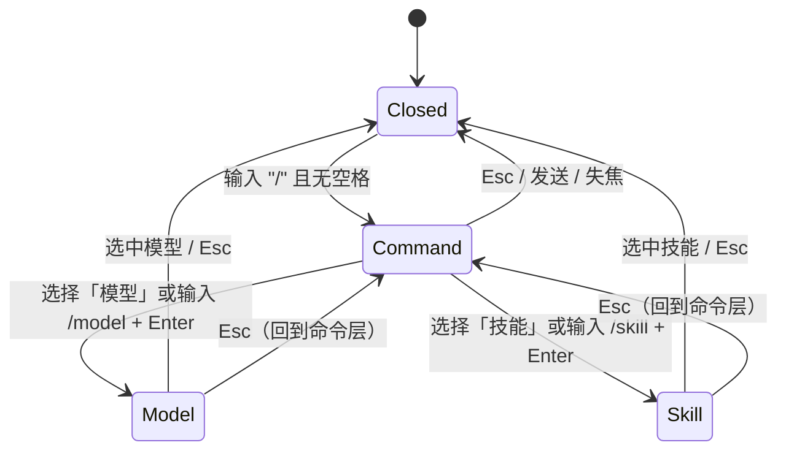

# 对话页交互与视觉方案（v2）

> 上游总览：[README.md](README.md)。接口契约：[api.md](api.md)。落地清单：[implementation.md](implementation.md)。
> 本版对话由 pi 子进程驱动：消息、工具调用、审批、模型与技能都来自 pi；壳只负责选择与展示。

## 1. 布局

### 1.1 现有结构

```text
#layout
├── #agent-rail          轨迹源选择
├── #sidebar             会话列表
├── #main                轨迹主区
└── #chat-drawer         对话栏（分屏，右侧）
    ├── #chat-resize     左缘调宽
    ├── #chat-list       消息流
    └── .chat-composer
        ├── #composer-resize  上边调高
        └── .chat-card
            ├── #chat-input   textarea
            └── .chat-row     #chat-send
```

### 1.2 新增结构

```text
#chat-drawer
├── #chat-resize
├── #chat-head                 对话头
│   ├── #chat-model            模型 chip（点击开 /model）
│   ├── #chat-profile          工具权限 chip（仅对话 / 只读 / 全量）
│   └── #chat-new              新对话
├── #chat-list                 消息流（user / ai / tool / notice）
├── .chat-composer
│   ├── #composer-resize
│   ├── #chat-context          上下文 chips + 计数 + 清空 + 「以此新开」
│   ├── #chat-palette          斜杠面板（绝对定位在输入卡上方）
│   └── .chat-card
│       ├── #chat-skill        技能 chip
│       ├── #chat-input
│       └── .chat-row
│           └── #chat-send     发送/停止二态
└── #chat-approval             审批弹层（覆盖抽屉内容，不阻塞轨迹区）
```

### 1.3 布局草图

```text
┌ 轨迹观察 ─────────────────────────────────────────── [主题] [对话] ┐
│ π │ 会话        │ 轨迹主区                          │ 对话        │
│   │ 会话 A      │                                   │ [GLM-5.3▾][只读▾][+]│
│   │ 会话 B      │  第 1 轮  ▾                       │             │
│   │             │   [x] 提问  帮我改…               │  用户气泡    │
│   │             │   [x] 工具  bash …                │  AI 回答     │
│   │             │   [ ] 回答  已完成                │  [工具卡片]  │
│   │             │                                   │             │
│   │             │                                   │ 上下文 2    │
│   │             │                                   │ [提问·…][工具·…]│
│   │             │                                   │ ┌─────────┐ │
│   │             │                                   │ │ /model… │ │
│   │             │                                   │ └─────────┘ │
└─────────────────────────────────────────────────────────────────┘
```

- 对话栏宽度、输入区高度沿用现有两个拖拽把手。
- 对话头高度约 36px，`border-bottom: 1px solid var(--dsw-alias-border-l1)`。
- 上下文 chips 在输入卡上方，横向可滚，最多一行，高度约 28px。

## 2. 对话头

```text
[ GLM-5.3 ▾ ]   [ 只读 ▾ ]                              [ + 新对话 ]
```

### 2.1 模型 chip

- 文本：当前线程模型 `name`；过长省略，`title` 给 `provider/id`。
- 图标：模型名左侧小圆点；`reasoning` 时 info 色，否则中性灰。
- 点击：等价输入 `/model`，打开模型面板；不弹原生 select。
- 模型不可用/回退时：chip 左侧警示圆点，`title` 说明原因。
- 流式中点击：提示「回复中，先停止」，不切模型。

### 2.2 工具权限 chip

- 三态：`仅对话`（no-tools）/ `只读`（read-only，默认）/ `全量`（full）。
- 点击：弹出小菜单，列出三档与一句说明：
  - 仅对话：只读轨迹工具，不能读项目文件。
  - 只读：可读项目文件（read/grep/ls），不能写、不能跑命令。
  - 全量：可写文件、可跑命令；每次执行前弹审批。
- 切档：`POST /api/chat/settings`；成功后 toast「对话进程已重启」；若流式中则先提示停止（409）。
- `全量` 开态用警示色（与裁剪/蒸馏的配色区分），`title` 说明「会真实修改工作区」。

### 2.3 新对话

- 加号按钮，`title="新对话"`；`POST /api/chat/thread`。
- 不弹确认；新线程清空消息与上下文选择，模型/profile 保留。
- 流式中禁用；若用户坚持，先停止再新建。
- 成功返回新 `threadId` 后写入 `localStorage["tw.chatThread"]["<source>:<sessionId>"]`。
- 关闭仍走顶栏对话按钮 / Esc，不在对话头放关闭按钮。

## 3. 斜杠面板

### 3.1 状态机



- 触发条件：输入框 trim 后匹配 `^/[A-Za-z]*$`（`/` 开头、没有空格）。
- `/skill:foo args` 有冒号/空格，不触发面板，直接按普通输入发送，由 pi 原生展开。
- 面板打开时 textarea 同时充当搜索框：
  - Command 层：过滤 `model`、`skill`；
  - Model/Skill 层：过滤对应列表。
- 切层清空输入并保持 textarea 焦点；Esc 回上一层时恢复进入面板前的草稿。
- 定位：`.chat-composer` 内 `position:absolute; left:10px; right:10px; bottom:calc(100% + 6px)`；`max-height:min(280px,50vh)`，内部滚动。
- 层级：高于消息流，低于对话头；点击面板外关闭。

### 3.2 外观

```text
┌─────────────────────────────────────┐
│ 模型                                │  ← 分组标题（按 provider 分组）
│  ✓ GLM-5.3        litellm           │
│    DeepSeek V4    litellm  推理 1M  │
│    Claude Sonnet  anthropic         │
├─────────────────────────────────────┤
│ 技能                                │
│    trajectory-web-maintenance       │
│    维护 trajectory-web 轨迹观察服务 │
└─────────────────────────────────────┘
```

- 每行：主文本 + 次文本；当前项左侧 `✓`。
- 键盘高亮用 `--dsw-alias-interactive-bg-hover`，不用选中蓝。
- 空结果：`没有匹配的模型` / `没有匹配的技能`；模型列表为空时给配置指引。

### 3.3 键盘

| 键 | Command 层 | Model/Skill 层 | 面板关闭时 |
|---|---|---|---|
| `↑` / `↓` | 移动高亮 | 移动高亮 | 无 |
| `Enter` | 进入子层 / 选择命令 | 选中并关闭 | 发送消息 |
| `Tab` | 同 Enter（可选） | 同 Enter（可选） | 切换焦点 |
| `Esc` | 关闭面板，恢复草稿 | 回 Command 层 | 走现有 Esc 链 |
| `Shift+Enter` | 换行 | 换行 | 换行 |

- IME 组合中（`e.isComposing`）不处理 Enter。
- 面板打开时 Enter 不发送消息；先在 `chat-input` 的 keydown 里判断面板状态。

## 4. 模型选择

1. 输入 `/` → Command 层。
2. 选「模型」或 `/model` + Enter → `GET /api/chat/models?refresh=1`，显示 loading 行。
3. 列表到达 → 按 provider 分组；当前线程模型打勾。
4. 选中 → `POST /api/chat/model`；成功后更新 chip、关闭面板、插入居中 notice `已切换到 GLM-5.3`。
5. 失败 → 面板内错误行，保持打开；不改 chip。

展示：

- 主文本：`model.name || model.id`。
- 次文本：`${provider}${reasoning ? " · 推理" : ""}${contextWindow ? " · " + fmtContextWindow(contextWindow) : ""}`。
- 当前项左侧勾，行背景保持普通。
- 搜索匹配 `name/id/provider/providerName`；多词 AND。
- 每次打开带 `refresh=1`；前端 5 秒内重复打开复用缓存。

## 5. 技能选择

### 5.1 流程

1. `/` → Command 层 → 「技能」。
2. `GET /api/chat/skills`；首次/切会话带 `refresh=1`，同一会话用 60 秒缓存（服务端）。
3. 面板按 scope 分组：用户、项目、包、路径；`scope` 缺失归到「其它」。
4. 选中 → 不立即请求，只显示技能 chip：
   ```text
   [ 技能：trajectory-web-maintenance  × ]
   ```
5. 发送时前端带 `skill: name`；服务端拼 `/skill:<name>` 前缀，pi 原生展开。
6. 发送成功 → chip 清除；失败 → chip 保留。
7. 再次 `/skill` → 替换当前 chip；一次只挂一个技能。

### 5.2 项目技能开关

- 技能面板顶部一行开关：`使用本项目技能`，默认关闭。
- 关闭时：只列全局技能（child 用 `-na`）。
- 打开时：`POST /api/chat/settings {projectSkills:true}` → 重启 child 并带 `--skill <projectPath>/.pi/skills`、`--skill <projectPath>/.agents/skills`（存在才加）。
- 开关按项目持久化；`title` 说明「会加载该项目的技能文件，可能包含第三方提示词」。

### 5.3 大小守卫与徽标

- 技能行次文本右侧显示 `chars` 量级（如 `1.8k`）；`> 32k` 用警示色。
- 选择超大技能时弹确认：`技能正文 236k 字符，可能超出上下文，仍要发送？`
- `> 200k` 直接禁用该行，`title` 说明「过大，请在 SKILL.md 里拆分」。
- `disableModelInvocation` 的技能仍可手动选择；行尾显示 `仅手动` 灰字。
- 列表为空：`pi 没有发现技能（检查 ~/.pi/agent/skills 或项目 .pi/skills）`。

### 5.4 直接输入

- `/skill:name args` 回车：不经过面板，服务端做大小守卫后原样发送；找不到技能按 pi 行为透传。
- `/skill` 后 Enter：进入技能列表，不发送。

## 6. 上下文管理

### 6.1 勾选框显示条件

- 显示：**对话栏打开** 或 **蒸馏模式开启**。
- 隐藏：两者都关。
- 实现：`selectMode = chatOpen || distillMode`；`renderEvent`/`renderMain` 用 `selectMode` 控制 `.ev-check`/`.q-check` 与 `no-select` 网格列。
- 打开/关闭对话栏时 `renderMain()` 一次；勾选状态在隐藏期间保留。

### 6.2 交互

- 行级 checkbox：勾选/取消该事件；点击不展开详情。
- 轮次头 checkbox：全选/取消全选本轮所有事件（含折叠、被过滤的）；三态 `all/some/none`。
- 勾选后：
  - `#chat-context` 立即出现 chip；
  - 写 `localStorage["tw.chatCtx"]`；
  - 不触发网络请求。
- 取消/清空：同步移除 chips 与存储；不影响已发送的历史。
- 上限 50；超出时忽略新勾选并提示。
- 切会话/切源：按 `source:sessionId` 保存/恢复。

### 6.3 增删语义（context-as-tool）

- 勾选变化只影响**下一轮**；流式中的请求使用发送时的快照。
- 加 4/5/6：下一轮清单出现，模型可读。
- 反选 2/3：下一轮清单消失；模型再按 id 读取会得到「不在当前选中集」。
- **反选不抹历史**：模型之前读过的内容仍在 session 里。UI 在 chips 旁给一句轻提示：`取消勾选只影响之后的读取`。
- 需要彻底失忆：用「以此新开」按钮（保留当前选择新开线程）或「新对话」（清空选择）。

### 6.4 Chips

```text
上下文 3  [提问 · 帮我改… ×] [工具 · bash … ×] [回答 · 因为… ×]  清空  以此新开
```

- 容器：`#chat-context`，`display:flex; flex-wrap:nowrap; overflow-x:auto; gap:6px;`。
- 单个 chip：
  - 主文本：`eventTagLabel(ev)`（提问/思考/工具/回答/命令/…）。
  - 次文本：`ev.preview` 截断 24 字，`title` 全文。
  - 点击 chip 主体：`openPanel(id)` 打开轨迹详情。
  - 点击 `×`：从选中集移除。
- 清空：清空当前会话所有选中；不弹确认。
- 失效条目（投影里已被裁剪/分支变化）：chip 显示 `失效条目` + `×`，发送时服务端跳过。
- `以此新开`：`POST /api/chat/thread` 后**保留**当前选中集；与对话头的「新对话」（清空选择）区分。

### 6.5 持久化

```json
{
  "pi:ext-1": ["a1:p2", "a2:p0"],
  "codex:thread-2": ["u1:user"]
}
```

- 键：`tw.chatCtx`；值：`{ "<source>:<sessionId>": ["eventId", ...] }`。
- 写入：勾选/取消/清空时立即写；切换会话前也写。
- 读取：页面启动、打开对话栏、切换会话/源、轨迹数据首次到达。
- 损坏 JSON → 重置 `{}`；不主动删除旧 key。
- 线程记忆：`tw.chatThread`，值 `{ "<source>:<sessionId>": "<pi session id>" }`；「新对话」成功后写入；没有记忆值时由服务端取最新。

## 7. 工具调用与审批

### 7.1 工具卡片

```text
┌ 工具 · read_trajectory ────────────── ✓ ┐
│ ids=["a1:p2"]                          │
│ 【工具】bash  npm test（exit 1）…       │
└────────────────────────────────────────┘
```

- 流式中先出现 `start` 卡片（工具名 + 参数摘要 + 旋转态）；`end` 后填结果、勾/叉、耗时。
- 参数与结果都折叠到固定高度（约 6 行），点击展开；超长给「展开全文」。
- 错误：卡片边框/图标用错误色，`isError` 时标题显示 `✗`。
- 工具卡片复用轨迹页的等宽/markdown 样式；`read_trajectory` 的结果按普通文本渲染。
- 同一 turn 内多个工具按顺序排列；不合并。

### 7.2 审批弹层

```text
┌──────────────────────────────────────┐
│ 允许执行命令？                    ⏱ 118s │
│ bash                                  │
│ ┌──────────────────────────────────┐ │
│ │ npm test                         │ │
│ └──────────────────────────────────┘ │
│ [ ] 本会话允许 bash                    │
│              [拒绝] [仅本次允许]        │
└──────────────────────────────────────┘
```

- 触发：SSE `approval` 事件；覆盖抽屉内容，不阻塞主轨迹区。
- 展示：标题、工具名、命令/path 摘要（截断 500 字）、倒计时（来自 `timeout`）。
- 操作：
  - `仅本次允许`：`POST /api/chat/approval {confirmed:true}`；
  - `本会话允许`：勾上后同上并带 `allowForSession:true`；
  - `拒绝` / `Esc` / 关闭：`{confirmed:false}`。
- 超时（默认 120s）：自动拒绝并关闭，插一条 notice `审批超时，已拒绝 bash`。
- 多个 pending：队列，一次显示一个；标题显示 `1/3`。
- 断连/刷新：服务端把所有 pending 视为拒绝；前端重新 `GET thread` 后不再显示弹层。
- `full` profile 才可能出现；`read-only`/`no-tools` 不弹。

### 7.3 安全提示

- 首次切到 `full`：弹一次确认 `全量工具会真实修改工作区，每次执行前会请求确认`。
- `full` 开态在对话头 chip 用警示色；关闭页面/切项目自动回到 `只读`？不自动，按项目记忆。
- 审批弹层不接受键盘快捷键「全部允许」；必须显式勾选。

## 8. 消息渲染

### 8.1 用户消息

```text
                                   ┌─────────────────────────┐
                                   │ 这个工具为什么失败？    │
                                   └─────────────────────────┘
                                   上下文 2 · 技能 trajectory…
```

- `.chat-msg.user` 右气泡、`--dsw-specific-bubble`、`--dsw-radius-xl`。
- `displayText` 用 `textContent`，保留换行（`white-space:pre-wrap`）。
- meta：`上下文 N`（有 context 时）、`技能 <name>`（有 skill 时）；模型名不重复显示。
- `上下文 N` 的 `title` 列出条目预览；点击可打开第一个条目（可选）。

### 8.2 AI 消息

```text
因为：
1. bash 返回 exit 1 …
2. …
────────────────────────
GLM-5.3 · 2.3s · 1.5K tokens
```

- `.chat-msg.ai`；正文 `mdNode(text)`。
- 流式中：容器 `is-streaming`；末尾闪烁光标；每 60–80ms 合并 delta 重渲染。
- 结束后：移除 `is-streaming`；`usage/durationMs` 存在时显示 meta 行。
- 思考内容 v1 不展示：`status {phase:"thinking"}` 时正文位置显示「思考中…」；首个 `delta` 替换。
- 只有 thinking 没有 text：显示「模型没有返回可见文本」。
- 错误/中断：气泡内保留部分文本，末尾红色 `生成中断：<message>` 或 `已停止`。

### 8.3 Notice

- 居中、caption 色、无气泡：`已切换到 GLM-5.3`、`已回退到 GLM-5.3`、`对话进程已重启`、`审批超时，已拒绝 bash`。
- 来自 SSE `notice` 或前端本地动作；不写入 pi session（模型切换本身由 pi 记录）。

### 8.4 空态与禁用态

| 状态 | 展示 |
|---|---|
| 对话未启用 | 消息流显示 `对话不可用：<reason>`；输入区 disabled；模型/profile chip 灰色 |
| 未选择会话 | `先在左侧选择一个会话`；输入区禁用 |
| 线程为空 | `选中左侧轨迹条目，然后提问。输入 / 选择模型或技能。` |
| 模型列表为空 | `pi 没有可用模型，先在 models.json / 登录里配置` |
| 加载线程 | 3 条骨架气泡，不转圈遮挡整个抽屉 |
| 发送失败 | 保留已输入内容；错误气泡；输入区恢复 |
| 流式中 | 发送按钮变停止；`#chat-new`/profile/模型 chip 禁用或提示「回复中」 |

## 9. 流式与滚动

- 发送后立即乐观渲染 user 消息，再等 `meta`；`meta` 前失败则移除或标记失败。
- 滚动：发送前距底部 `< 80px` 则自动跟随；用户上滚则显示「回到底部」小按钮；结束后若原本在底部则滚到最终位置。
- 停止：发送按钮图标 `↑` → `■`，`aria-label="停止生成"`；点击 `POST /api/chat/stop`，按钮立即 disabled，等 `done/error` 恢复。
- 窗口隐藏时不断流；回来若流已结束，`GET thread` 刷新一次最终状态。
- `done` 后整表替换消息列表，按消息 id 去重，避免乐观消息与服务器投影重复。

## 10. 键盘与可访问性

- 输入框：Enter 发送；Shift+Enter 换行；IME 组合中不发送。
- 面板：↑↓ 移动，Enter 选择，Esc 逐层关闭；`role="listbox"`、`role="option"`、`aria-selected`；`aria-activedescendant` 指向高亮项。
- 面板打开时 textarea 保持焦点，不把焦点移到面板。
- 审批弹层：打开时焦点移到弹层；Tab 在三个操作间循环；Esc = 拒绝；关闭后焦点回输入框。
- 上下文 chips：每个 chip 是 button；`×` 独立 button，`aria-label="移除上下文：<label>"`；清空按钮 `aria-label="清空对话上下文"`。
- 发送/停止：`aria-label` + `title`；流式中 `aria-busy="true"` 挂在消息流容器；**流式期间 `aria-live="off"`**，结束后恢复 `polite` 并播报最后一条。
- 颜色对比：沿用现有 token；profile 全量态用警示色 + 文案，不只靠颜色。

## 11. 样式约定

- 复用 `trajectory-web/web/tokens.css` 的 deepseek token，不新增色板。
- 新增规则放在 `style.css` 的对话栏区块内，顺序：对话头 → 上下文 chips → 面板 → 消息/工具卡片 → 输入卡 → 审批弹层。
- 建议：
  - 面板/卡片背景：`--dsw-alias-bg-layer-1`；
  - 发丝线：`--dsw-alias-border-l1` / `--dsw-alias-border-l2`；
  - 悬停：`--dsw-alias-interactive-bg-hover`；
  - 主文本：`--dsw-alias-label-primary`；次要：`--dsw-alias-label-secondary` / `--dsw-alias-label-caption`；
  - 错误：现有 `.k-error` 同色系；警示：与裁剪按钮同色系；
  - 圆角：chip `--dsw-radius-sm`，面板/输入卡 `--dsw-radius-lg`；
  - 字体：正文 14/22，meta 11，面板项 13，工具卡片 12/18。
- 暗色：全部走 token；审批遮罩固定 `rgba(0,0,0,.32)`，卡片用 layer-1。
- 动效：面板 120ms 淡入/上移 4px；流式光标 1s 闪烁；尊重 `prefers-reduced-motion`。

## 12. 响应式

- 对话栏最小 260px：
  - 模型 chip `max-width:140px`，profile chip 只显示图标或短词（`仅`/`读`/`全`），`title` 给全称；
  - 上下文 chips 横向滚动，不换行；
  - 面板项次文本隐藏。
- 窄窗口（< 900px）：对话栏仍参与分屏；面板宽度跟随抽屉；审批卡片 `width:min(92%,420px)`。
- 输入区手动拖高时，面板仍锚定在输入卡上方；可视高度不足时 `max-height:40vh`。
